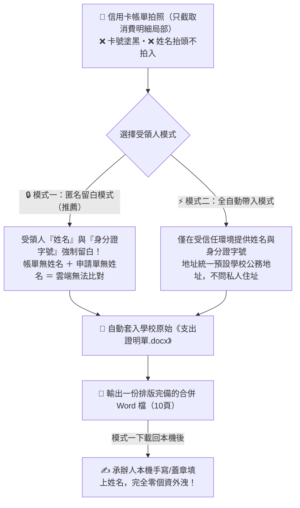

> 💳 **【AI 行政實戰】一張信用卡帳單 ➔ 10 張支出證明單一鍵套表生成！**  
> 誰說 AI 只會聊天？它最擅長的是幫行政同仁調動文件、消滅重複繁瑣的 routine 報帳瑣事！  
> **核心理念：** 執行同仁才是最強大腦，AI 是你養的勤勞小幫手。  
> **兩大亮點：** 🔒「匿名留白模式」徹底消除個資比對疑慮 ＋ 📄 100% 直接套用學校原始 Word 範本檔。  
> 👉 **線上互動體驗網站：** [https://qqnice.github.io/admin/expense-vouchers/](https://qqnice.github.io/admin/expense-vouchers/)

---

## 一、 報帳現場的真實痛點：為什麼 5 筆海外刷卡要填 10 張單？

最近許多老師與研究計畫助理常需要在國外網站刷卡購買 AI 軟體與雲端服務（例如 OpenAI ChatGPT、Anthropic Claude、Grok XAI、Tavus、Midjourney 等）。

但一到月底報帳時，惡夢就來了：

> 😱 **學校主計法規規定：**  
> 國外交易的「軟體本金」與銀行收取的「國外交易手續費」，必須**分別開立支出證明單**，不能合併算成一筆！

這意味著：
- 帳單上只要有 **5 筆海外刷卡**，每筆都有「交易款 ＋ 國外交易手續費」。
- **5 筆交易 ＝ 瞬間暴增成 10 張支出證明單**！
- 每一張證明單都要人工填寫：
  1. **支出事由**（手續費還得寫「○○元交易之手續費」）
  2. **單價與數量**（數量填 1）
  3. **實付金額大寫**（例如「新臺幣690元整」）
  4. **不能取得單據原因**（本金填「境外廠商無法列印電子發票證明」、手續費填「國外交易手續費，無法取得單據」）
  5. **日期換算民國年**
  6. **經手人欄位必須留白**（避免同仁誤簽）

助理或老師必須對照帳單，在 Word 表格裡**重複複製貼上 10 次**。不僅耗時、枯燥、手痠眼花，還常常金額打錯、大寫漏字被主計室退件！

---

## 二、 核心理念：你是大腦，AI 是你養的勤勞小幫手

面對這種 routine 的重複工作，我們的解題思路不是「硬著頭皮加班做」，而是：

> **「各位執行同仁都是最主要的大腦，而這些 AI、這些 Skill 就是你養的小幫手。」**

> 💡 **日常行政自動化的黃金法則：**  
> AI 最擅長幫大家處理平常很瑣碎、很規律的事情。  
> **只要這些瑣事我們能想出好方法把工作拆解完成，就可以交給 AI 處理！**

你不需要自己動手打 10 份表格，你的工作是**「動腦下決策」**：
1. 拿出螢光筆，在帳單上把要報帳的項目畫起來（例如標記 A、B、C、D、E）。
2. 打開對話，用講的對 AI 下指令。
3. AI 小幫手立刻讀取帳單上的標記，自動調動學校的 Word 原始檔，3 秒鐘生成一份排版完美的 10 頁合併 Word 檔！

---

## 三、 徹底破解個資疑慮：雙模式與「零比對」安全設計

推廣行政 AI 時，同仁與長官最常問的一個嚴肅問題就是：
> **「把信用卡帳單上傳給 AI，難道不會有個人資料外洩的風險嗎？」**

我們的回答非常堅定：**當然不能把個人隱私給 AI！**  
為此，這個 Skill 設計了從源頭杜絕風險的**「雙模式架構」**：



### 🔒 模式一：匿名留白模式（個資零外洩・強烈推薦）
- **設計哲學：** 「如果申請單上有寫是誰買的，當然可能被比對出來。假設有這種疑慮，**直接讓它生成沒有使用者的名單就好！**」
- **做法：**
  1. 拍照時只拍消費金額與品名明細，卡號塗黑，帳單上方的姓名抬頭完全不要拍進去。
  2. 對話時，**完全不提供申請人姓名與身分證字號**給 AI。
  3. AI 生成支出證明單時，受領人的「姓名或名稱」、「身分證字號」欄位**一律保持空白**！
- **成果效果：** 帳單上沒有名字，生成出來的 Word 檔上也完全沒有名字！AI 在雲端只看到「有一筆 690 元的 OpenAI 交易」，**永遠無法知道這張帳單到底屬於哪位同仁，徹底消滅任何個資外洩與比對的可能！**
- 同仁下載回自己的電腦後，直接印出，再手寫或蓋私章即可核銷。

### ⚡ 模式二：全自動帶入模式（適合受信任內部環境）
- 如果同仁評估在受信任的校內/付費專屬環境操作，希望連同受領人資訊一次印好，可提供姓名與身分證字號。
- **安全防線：** 地址**強制預設為學校公務地址**（台中市北區三民路三段129號），絕不詢問個人住址，也不會將私人家裡地址印在公用憑證上。

---

## 四、 堅持原檔套表：直接調動你的 Word 檔，絕不自創野生表格

很多人嘗試用 AI 做公務文件，最大的痛點往往是：
> 「AI 每次生出來的表格都不一樣！格線粗細跑掉、字型不對、缺少附註，印出來拿去行政單位一定被退件！」

這正是這個 Skill 的另一大關鍵特色：

> 🎯 **讓 AI 直接用你原本的 Word 檔去生成：**  
> 我們不是叫 AI「憑空畫一個表格」，而是把學校主計室提供的標準 **`支出證明單.docx`** 原始檔當作範本交給它！

Skill 會透過程式調動原檔，複製原始表格的格線、邊界與樣式，填入計算好的文字與金額，最後合併儲存成單一檔案：

| 欄位名稱 | 📄 第 1 張：交易款憑證 | 🧾 第 2 張：國外交易手續費憑證 |
| :--- | :--- | :--- |
| **貨物名稱或事由** | 沿用帳單品名（如：`OPENAI A`） | 原品名＋原金額＋「元交易之手續費」（如：`OPENAI A 690元交易之手續費`） |
| **單位與數量** | `1` | `1` |
| **單價** | 交易款總額（如：`690`） | 手續費金額（如：`10`） |
| **實付金額** | 自動轉中文（如：`新臺幣690元整`） | 自動轉中文（如：`新臺幣10元整`） |
| **不能取得單據原因** | `境外廠商無法列印電子發票證明` | `國外交易手續費，無法取得單據` |
| **受領人資料** | 依模式決定：匿名模式留白；全自動模式填入已確認姓名與身分證 | 依模式決定：匿名模式留白；全自動模式填入已確認姓名與身分證 |
| **經手人欄位** | **強制留白！** 保留格線但不填字，由經手人印出後親自核章 | **強制留白！** 保留格線但不填字，由經手人印出後親自核章 |

### 🛡️ Skill 內建的嚴格限制規則（避免 AI 擅作主張）：
1. **絕不合併金額：** 嚴禁將 690 元與 10 元擅自合併成一張 700 元憑證。
2. **手續費自動補正：** 即使帳單上的手續費漏畫螢光筆，只要主交易有標記，AI 就會自動抓取相鄰對應手續費生成第 2 張。
3. **刷退防呆排除：** 帳單上出現正負相抵的刷退交易（如 `+1818` 與 `-1818`），自動辨識並排除，絕不印出負數或錯誤憑證。
4. **排除指定廠商：** 若同仁說「排除 TYPELESS」，該廠商的主交易與手續費自動全部剔除。
5. **單一合併檔輸出：** 10 頁直接串接在同一個 Word 檔中（每張一頁），不產生 10 個零散檔案。

---

## 五、 手把手操作示範：只要三步搞定！

### Step 1：拿螢光筆標記帳單局部拍照 📸
拿出印出的信用卡帳單，用黃色螢光筆把這次要報帳的項目畫起來（旁邊可手寫 A、B、C 輔助辨識）。  
拍照時請注意：**只要拍有消費的局部表格即可，上方的帳單人姓名、地址與卡號通通不要拍進去！**

### Step 2：把照片丟給 AI，複製這句指令 💬

#### 模式 A：【匿名安全模式】（推薦・零個資疑慮）
```text
請使用「支出證明單」技能，幫我依這張信用卡帳單的螢光筆標記製作合併 Word 檔。
我要使用「匿名留白模式」（受領人姓名與身分證字號留白保護個資），將每筆交易款與國外交易手續費分開各做一張！
```

#### 模式 B：【全自動填入模式】（一次填妥）
```text
請使用「支出證明單」技能，幫我依這張信用卡帳單的螢光筆標記製作合併 Word 檔。
申請人姓名：王小明，身分證字號：B123456789。請將每筆交易款與國外交易手續費分開各做一張！
```

### Step 3：下載一鍵生成的 Word 檔，印出核銷 🖨️
AI 會在 3 秒內回傳一份 `支出證明單_1151024_共10張.docx`。  
打開後 10 頁格式完全一致、金額與大寫自動核對無誤、經手人位置留白，直接送印蓋章！

---

## 六、 舉一反三：把這套思維類推到平常所有 Routine 工作！

這份「信用卡支出證明單」不僅僅是一個工具，更是一個**極佳的觀念範例**！

平常學校與公家機關有大量類似的工作：
> **「拿著固定的外部資料 ➔ 填進學校規定的一套固定表格 ➔ 印出跑流程」**

只要掌握以下**「三要素拆解法」**，任何 routine 工作都能交給 AI 幫你做：

> 🧩 **行政業務 AI 化的三要素公式：**  
> 1. **最小必要輸入（資料）：** 只給 AI 執行任務必需的純事實（隱去不相干的個資與敏感資訊）。  
> 2. **原本在用的範本（容器）：** 直接拿機關現存的標準 Word / Excel 檔當範本。  
> 3. **清楚受控的規則（邊界）：** 把人機邊界講清楚（什麼情況填什麼、哪裡要留白、哪些要排除）。

### 🏫 四個常見校園行政情境類推表：

| 行政業務情境 | 📥 輸入資料 | 📄 綁定的原始範本 | ⚡ AI 小幫手自動做完的事 |
| :--- | :--- | :--- | :--- |
| **1. 海外刷卡核銷<br/>（本篇範例）** | 信用卡帳單局部照片 | 學校原始《支出證明單.docx》 | 本金與手續費自動拆開、大寫轉換、免手打 10 次表格、個資可選留白。 |
| **2. 演講鐘點費核銷** | 活動簽到名冊、講座時數 | 學校標準《演講費印領清冊.docx》 | 自動區分校內外師資標準鐘點費、計算二代健保補充保費，套入領據合併印出。 |
| **3. 差旅與機票報帳** | 電子機票行程單、住宿收據 | 學校《國外出差旅費報告表.docx》 | 自動抓當日台幣匯率折算、依出差地點查出日支生活費標準，排進標準報銷表格。 |
| **4. 研習獎狀批次套印** | 完訓學員 Excel 名冊 | 學校《標準獎狀/聘書.docx》 | 鎖定校印位置與中文字距，3 秒鐘生成 50 頁排版完全相同的獎狀 Word 檔。 |

---

## 七、 相關資源與檔案下載

- 🌐 **線上互動體驗網站（免安裝即可體驗操作）：**  
  [https://qqnice.github.io/admin/expense-vouchers/](https://qqnice.github.io/admin/expense-vouchers/)
- 📦 **信用卡支出證明單技能包（ZIP 下載）：**  
  [支出證明單_skill.zip](https://qqnice.github.io/admin/expense-vouchers/支出證明單_skill.zip)
- 🗂️ **AI 協助行政自動化專區首頁：**  
  [https://qqnice.github.io/admin/](https://qqnice.github.io/admin/)

---

> ☕ **結語：**  
> 把繁瑣、重複、容易出錯的行政瑣事交給 AI，把省下來的時間，留給自己做真正有創造力、想做的事情！
