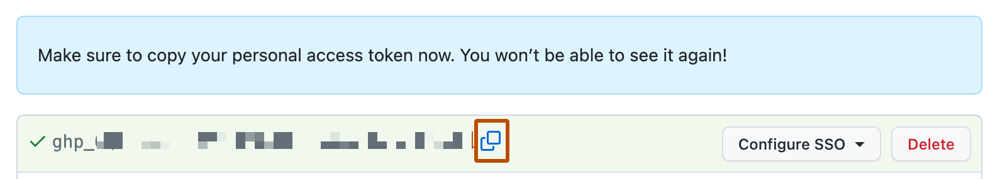
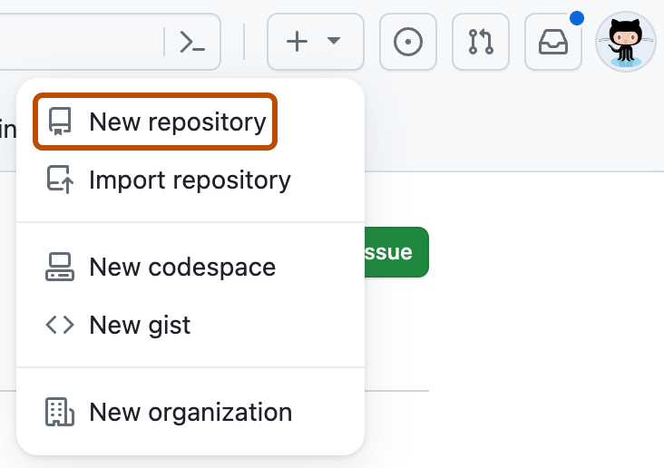
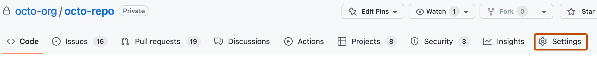

# Antigravity × GitHub 串接與「下 Prompt 自動完成」教學手冊

**對象：**已完成 GitHub 帳號申請與 2FA 設定的學生與教師  
**核對日期：**2026 年 10 月 26 日  
**核心特色：**不需背誦複雜的 Git 終端機指令！只要複製本手冊提供的**中文 Prompt（提示詞）**貼給 Antigravity Agent，並對照 GitHub 真實頁面完成一次性授權，就能自動完成「設定身分 → 登入串接 → 建立儲存庫 → 推送程式碼 → 發佈 GitHub Pages 公開網頁」。

---

## 先看結論：為什麼在 Antigravity 裡不用自己背 Git 指令？

傳統教學要學生背 `git init`、`git remote add`、`git branch -M main`、`git push -u origin main`，初學者常因為少打一個參數或權限設定錯誤而卡關。

在 **Google Antigravity（Antigravity IDE 或 Antigravity 2.0 桌面版）** 中，Agent 擁有專案終端機與檔案操作能力。你只需要做兩件事：
1. **在瀏覽器完成一次性 GitHub 網頁授權**（確認是本人帳號）。
2. **在 Antigravity 對話框貼上一句中文 Prompt**，由 Antigravity 自動幫你執行環境檢查、建立遠端儲存庫、設定 `.gitignore`、Commit、Push 與開啟 GitHub Pages。

> **資安底線提醒：**切勿把你的 GitHub 登入密碼、2FA 復原碼或 Personal Access Token (PAT) 直接貼進公開程式碼檔案裡！請優先使用官方 **GitHub CLI (`gh auth login --web`)** 的瀏覽器一鍵授權（Device Flow），安全又免貼金鑰。[來源：GitHub CLI 快速入門](https://docs.github.com/en/github-cli/github-cli/quickstart)

---

## 步驟 1　在 Antigravity 開啟專案並下 Prompt 設定 Git 身分

1. 打開 **Antigravity**，確認目前工作區（Workspace / Project）已開啟你的網站或程式專案資料夾。
2. 在 Antigravity 對話框（Sidebar Chat 或 Chat Canvas）直接貼上下方 **Prompt 1**：

```text
請幫我檢查這台電腦是否已安裝 git 與 GitHub CLI (gh)，並將我的 Git 全域使用者名稱設定為「你的GitHub帳號Username」、信箱設定為「你的GitHub驗證信箱」，設定完成後請列出目前的 git config 讓我確認。
```

* **真實頁面核對：**若不想公開私人信箱，可先開啟真實頁面 **[GitHub Settings → Emails](https://github.com/settings/emails)**，勾選 `Keep my email addresses private`，並複製頁面提供的 `數字+username@users.noreply.github.com` 隱私信箱給 Antigravity 設定。

---

## 步驟 2　下 Prompt 啟動 GitHub 瀏覽器一鍵授權（推薦首選）

GitHub 已不再支援於指令列直接使用「帳號＋密碼」推送程式碼，必須透過 **GitHub CLI 網頁授權**、**SSH 金鑰**或 **Personal Access Token (PAT)**。對師生最簡單、最安全的方式是 **GitHub CLI (`gh`) 網頁授權**：

1. 在 Antigravity 對話框貼上下方 **Prompt 2**：

```text
請幫我檢查 GitHub CLI (gh) 的登入狀態（gh auth status）。如果還沒登入，請幫我安裝好 gh（若尚未安裝）並啟動瀏覽器網頁授權（gh auth login --hostname github.com --git-protocol https --web），告訴我畫面上的 8 碼一次性驗證碼（One-time code），並引導我到 https://github.com/login/device 完成點擊授權。
```

2. 開啟真實授權頁面 **[https://github.com/login/device](https://github.com/login/device)**（GitHub Device Activation 頁面）。
3. 輸入 Antigravity 終端機顯示的 **8 碼單次驗證碼（One-time code）** → 點擊綠色的 **`Continue`** → 在權限確認頁點擊 **`Authorize github`**。
4. 回到 Antigravity 說「我已完成網頁授權」，Antigravity 執行 `gh auth status` 顯示 `✓ Logged in to github.com` 即代表串接成功！

---

## 步驟 3　（替代方案）使用 GitHub Personal Access Token (PAT) 网页授權

如果學校電腦環境無法使用 `gh auth login`，可改從 GitHub 真實設定頁產生 **Personal Access Token（個人存取權杖）**：

1. 開啟真實頁面：**[GitHub Settings → Developer settings → Personal access tokens](https://github.com/settings/tokens)**（建議選 [Fine-grained tokens](https://github.com/settings/personal-access-tokens/new)）。
2. 點擊 **`Generate new token`**，填寫名稱（如 `antigravity-mac`）、設定有效期限（Expiration），並在 Repository permissions 將 **`Contents`** 設為 **`Read and write`**。
3. 產生後，依照 GitHub 官方畫面提示（`Make sure to copy your personal access token now. You won’t be able to see it again!`），點擊複製圖示把 Token 存進系統鑰匙圈，**千萬不要把 Token 寫進程式碼或交給別人**。[來源：管理個人存取權杖](https://docs.github.com/en/authentication/keeping-your-account-and-data-secure/managing-your-personal-access-tokens)



---

## 步驟 4　下 Prompt 一鍵建立 GitHub 遠端儲存庫（Repository）並首次推送

完成步驟 2 授權後，連開網頁建儲存庫都可以直接交給 Antigravity 自動完成（或對照 **[https://github.com/new](https://github.com/new)** 真實頁面操作）：

1. 在 Antigravity 對話框貼上下方 **Prompt 3**：

```text
請幫我把目前這個專案資料夾初始化為 Git 儲存庫（主分支設為 main），先幫我建立好 .gitignore 排除系統暫存檔與機敏檔案（如 .DS_Store、.env、node_modules），接著進行第一次 Commit，並直接在我的 GitHub 建立一個名為「my-first-project」的公開（Public）儲存庫，把程式碼完整推送（Push）上去，最後給我 GitHub 儲存庫的真實網址。
```

* **真實頁面核對：**
  * 網頁右上角點 **`+`** → **`New repository`**（或直達 **[https://github.com/new](https://github.com/new)**）。
  * 在 **`Repository name *`** 看到綠色的名稱可用提示，選擇 `Public`（公開作品集）或 `Private`（私人作業）。
  * 推送完成後，點開 Antigravity 給你的 `https://github.com/你的Username/儲存庫名稱`，即可在真實 GitHub 頁面看到所有檔案！




---

## 步驟 5　修改內容後，下 Prompt 一句話自動同步更新（Add + Commit + Push）

日後當你在 Antigravity 修改了網頁、新增圖片或調整功能後，只要貼上下方 **Prompt 4**：

```text
請幫我檢查目前專案修改了哪些檔案（git status），確認沒有包含任何密碼或機敏檔案後，幫我寫一段清楚的繁體中文 Commit 訊息，將所有變更提交並推送（git push）到 GitHub 遠端儲存庫。
```

---

## 步驟 6　下 Prompt 自動開啟 GitHub Pages，把網頁發佈成公開網址

如果你的專案是靜態網站（包含 `index.html`、`style.css`、`app.js`），可以請 Antigravity 直接幫你開啟 **GitHub Pages**，或對照真實設定頁面完成：

1. 在 Antigravity 對話框貼上下方 **Prompt 5**：

```text
請幫我把目前這個 GitHub 儲存庫的 main 分支設定發佈為 GitHub Pages 網站（若需要調整資料夾結構或透過 gh api 開啟 Pages 請直接幫我設定好），完成後請幫我確認部署狀態，並提供最終可以打開瀏覽的 https://<username>.github.io/<repo>/ 公開網址。
```

* **真實頁面核對（手動查看位置）：**
  1. 在你的 GitHub 儲存庫頁面上方點選 **`Settings`**（齒輪頁籤）。
  2. 在左側邊欄 `Code and automation` 區點擊 **`Pages`**。
  3. 在 `Build and deployment` → **`Branch`** 下拉選單將 `None` 改為 **`main`**（資料夾選 `/ (root)` 或 `/docs`），按下 **`Save`**。等待約 1～2 分鐘即可打開 `https://你的Username.github.io/儲存庫名稱/`！[來源：設定 GitHub Pages 發佈來源](https://docs.github.com/en/pages/getting-started-with-github-pages/configuring-a-publishing-source-for-your-github-pages-site)




---

## 步驟 7　課堂協作與分支保護：下 Prompt 拉取最新版本與建立 PR

當你在不同電腦工作，或與老師、同學共同維護同一個儲存庫時，直接貼上下方 **Prompt 6**：

```text
請先幫我從 GitHub 拉取（git pull）遠端最新版本，接著幫我建立並切換到一個新分支「feature-update」，把目前的修改提交並推送到該分支，最後幫我在 GitHub 建立一個 Pull Request (PR) 並給我 PR 連結。
```

---

## 常見問題（Antigravity × GitHub 串接篇）

| 常見狀況 | 貼給 Antigravity 的一鍵排解 Prompt |
|---|---|
| `gh: command not found`（找不到 gh 工具） | `請幫我檢查系統環境並用 Homebrew 或官方安裝方式安裝 GitHub CLI (gh)，安裝後執行 gh --version 確認。` |
| 推送時出現 `Permission denied` 或 `403` | `我推送到 GitHub 時遇到權限錯誤，請幫我用 gh auth status 檢查目前登入的帳號與 token 權限，並設定 gh auth setup-git。` |
| 不小心把大檔案或 `.DS_Store` 加進去了 | `請幫我從 Git 追蹤清單中移除 .DS_Store 與不該上傳的暫存檔（保留本機檔案），更新 .gitignore 並重新提交推送。` |
| 遠端與本機進度衝突（Rejected / Non-fast-forward） | `遠端 GitHub 儲存庫有我還沒拉下來的更新，請幫我用 git pull --rebase 安全整合遠端變更並重新推送到 GitHub。` |

---

## 真實頁面與官方文件索引

| 用途 | 真實頁面或官方說明 |
|---|---|
| 裝置授權驗證頁（輸入 8 碼） | [https://github.com/login/device](https://github.com/login/device) |
| 建立新儲存庫真實頁面 | [https://github.com/new](https://github.com/new) · [GitHub Docs：建立新儲存庫](https://docs.github.com/en/repositories/creating-and-managing-repositories/creating-a-new-repository) |
| 個人存取權杖（PAT）設定頁 | [Fine-grained PAT 設定頁](https://github.com/settings/personal-access-tokens/new) · [GitHub Docs：管理 PAT](https://docs.github.com/en/authentication/keeping-your-account-and-data-secure/managing-your-personal-access-tokens) |
| SSH 金鑰設定頁 | [https://github.com/settings/keys](https://github.com/settings/keys) · [GitHub Docs：新增 SSH 金鑰](https://docs.github.com/en/authentication/connecting-to-github-with-ssh/adding-a-new-ssh-key-to-your-github-account) |
| GitHub CLI 官方教學 | [GitHub Docs：GitHub CLI Quickstart](https://docs.github.com/en/github-cli/github-cli/quickstart) |
| GitHub Pages 官方教學 | [GitHub Docs：設定 GitHub Pages 發佈來源](https://docs.github.com/en/pages/getting-started-with-github-pages/configuring-a-publishing-source-for-your-github-pages-site) |
| Google Antigravity 官方文件 | [https://antigravity.google/docs](https://antigravity.google/docs) |
