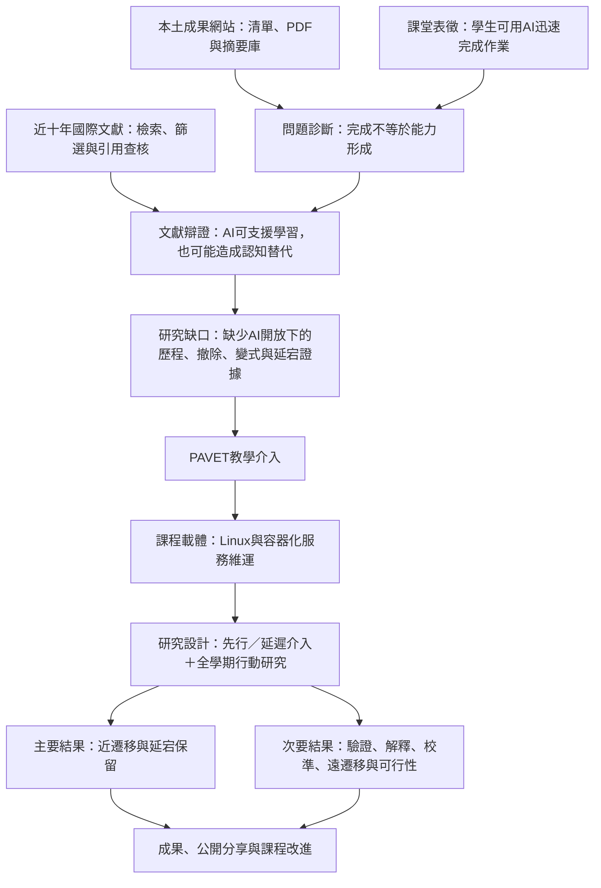

# 從課堂問題到可執行的教學實踐研究計畫

## 以「AI開放情境下的Linux真實學習」為例之研究計畫撰寫教學手冊

## 一、這份手冊要解決什麼問題

許多教師開始撰寫教學實踐研究計畫時，會直接從「我要使用哪一種教學法」或「我要比較前後測」開始，結果常出現下列問題：

- 課堂問題只有現象，沒有辨識背後機制。
- 文獻很多，卻沒有形成正反辯證與研究缺口。
- 研究目的、研究問題、假設、資料與分析彼此不一致。
- 教學介入有名稱，卻說不清楚它如何改變學生學習。
- 只測量滿意度、期末成品或AI在場的表現，無法回答學生是否真正學會。
- 研究方法看似複雜，卻不符合單班、小樣本與真實教學場域。

本手冊重建本研究計畫從「蒐集成果網站資料與文獻證據」到形成完整研究設計的過程，並將其整理成兩個前置實作與七個核心教學單元。讀者不需要複製PAVET或Linux主題，而是學習如何完成下列五條對齊鏈：

1. **問題鏈：**課堂表徵 → 直接原因 → 深層機制 → 可蒐集證據。
2. **論證鏈：**支持文獻 → 反方文獻 → 條件性結論 → 研究缺口。
3. **研究鏈：**研究目的 → 研究問題 → 假設 → 資料 → 分析。
4. **教學鏈：**學習成果 → 教學介入 → 課堂活動 → 評量證據。
5. **成果鏈：**工作項目 → 學生效益指標 → 公開分享 → 社群貢獻。

本手冊適合大專校院教師、教學發展中心、教師社群及研究計畫撰寫工作坊使用。完整教學時間約十六小時，可安排為兩日密集工作坊，也可拆成九次教師社群活動。若參與者已完成資料庫建置與文獻查核，可只使用後七個核心單元。

---

## 二、完成本教學後的學習成果

完成兩個前置實作與七個核心單元後，參與者應能：

1. 界定成果網站資料蒐集範圍，建立可重現的成果清單、PDF檔案庫與下載紀錄。
2. 從大量成果報告中擷取正式摘要或具明確來源標記的替代摘錄，並記錄頁碼、狀態及異常。
3. 對全部成果清單進行廣篩與精篩，而非只搜尋與題目完全相同的計畫名稱。
4. 建立近十年國際文獻檢索式、納入排除準則、證據編碼表與引用查核表。
5. 從課堂觀察中區分「表面現象」與「可研究的深層問題」。
6. 建立本土教學案例與國際研究文獻的證據地圖。
7. 以正方、反方、條件及缺口的方式撰寫文獻探討。
8. 寫出彼此對齊的研究目的、研究問題、假設與操作型定義。
9. 說明教學介入的作用機制，而不是只替活動命名。
10. 將研究介入嵌入真實課程、評量與週次安排。
11. 選擇符合班級規模、倫理與教學公平的研究設計。
12. 建立研究問題、資料工具、測量時間與分析方法的對照表。
13. 寫出可驗收的教學成果、學生學習指標及成果分享方案。
14. 使用一致性檢核與決策紀錄，完成可追蹤、可修訂的研究計畫草案。

---

## 三、我們的實際案例：從一句課堂抱怨到研究計畫

### （一）最初的課堂描述

教師最初提出的困擾是：

> 學生取得題目或樣板後，直接詢問GPT，再把答案或指令貼回作業。即使作業完成，教師仍不知道是AI完成還是學生理解後完成，也不知道學生真正提升了什麼能力。

如果直接把這句話當成研究問題，容易把計畫寫成「如何防止學生使用AI」或「比較有沒有用AI」。我們逐步將問題重新界定為：

> 在允許使用生成式AI的Linux技術實作課程中，如何促進並辨識可歸因於學生本人的診斷、驗證、解釋、保留與遷移能力？

### （二）五個關鍵轉折

| 初始想法 | 發現的問題 | 修正後的決策 | 為什麼要修正 |
|---|---|---|---|
| 學生把GPT答案貼上來 | 把問題只視為作弊，無法解釋學生為何依賴及評量為何失效 | 改寫為「任務完成與學習可能脫鉤、評量推論效度不足」 | 研究焦點由抓人轉為改善學習與證據 |
| 禁止學生使用AI | 不符合Linux與雲端工作的真實環境，也無法教導負責任使用 | 大部分任務開放AI，只在短時能力證據窗口暫停AI | 同時保留工作真實性與個人能力測量 |
| 只看期末成品 | 正確成品可能是人機聯合產出，不能直接代表學生理解 | 建立PAVET：預判、AI協作、驗證、解釋、遷移 | 蒐集成品以外的過程與獨立表現證據 |
| 期末做網站、LAMP或WordPress | 網站開發能力會干擾本研究真正要測的系統維運能力 | 收斂為容器化服務部署、監控告警與災難復原 | 讓教學內容、專業能力與研究測量更一致 |
| 採AB／BA交叉設計 | 學生學會PAVET後不可能完全退回未介入狀態，容易有攜帶效果 | 改採分層隨機的先行／延遲介入設計 | 兼顧短期比較、教學公平及設計效度 |

### （三）最後形成的研究邏輯



---

## 四、兩個前置實作與七個核心單元總覽

| 單元 | 主題 | 建議時間 | 參與者完成的核心產出 |
|---:|---|---:|---|
| P1 | 教學實踐成果網站資料蒐集、下載與摘要庫建置 | 120分鐘 | 完整清單、PDF檔案庫、摘要資料表、異常紀錄 |
| P2 | 全成果廣篩、近十年國際文獻檢索與引用查核 | 120分鐘 | 本土證據地圖、檢索紀錄、文獻編碼表、引用查核表 |
| 1 | 將本土成果轉為研究設計線索 | 75分鐘 | 本土案例摘要表、可借用設計元素 |
| 2 | 從課堂表徵找出真正研究問題 | 90分鐘 | 表徵—原因—機制—證據矩陣 |
| 3 | 文獻前後辯證與缺口形成 | 120分鐘 | 文獻證據地圖、辯證表、缺口陳述 |
| 4 | 目的、問題、假設與介入機制 | 105分鐘 | 目的—RQ—假設—變項對照、介入邏輯鏈 |
| 5 | 將研究介入嵌入課程與評量 | 105分鐘 | 學習成果—活動—評量—研究節點課程地圖 |
| 6 | 研究方法、工具、分析與倫理 | 150分鐘 | 研究架構、資料工具矩陣、分析方案、實施流程 |
| 7 | 預期成果、公開分享與整體稽核 | 75分鐘 | 工作成果表、學習指標、分享規劃、最終檢核表 |
|  | **合計** | **960分鐘** | 一套可追溯的證據庫與一份可進入正式申請書撰寫的研究計畫骨架 |

每個前置實作與核心單元均採「喚起經驗—概念輸入—案例示範—實作產出—同儕檢核—修訂收束」流程。若時間不足，優先保留實作產出與檢核，不要只剩教師講述。

---

## 前置實作一　教學實踐成果網站資料蒐集、下載與摘要庫建置

### 實作目的

研究題目形成之前，先建立「目前有哪些本土研究、哪些報告可取得、每份報告說了什麼」的可追溯資料庫。這個階段不是為了找一份題目相同的計畫來模仿，而是避免只憑個人印象選題，也讓後續的案例篩選、研究方法借鏡及缺口判斷有完整母體可回查。

### 本實作在整體流程中的位置


先建完整清單，再用關鍵詞篩選。若一開始只搜尋「ChatGPT」或「Linux」，會漏掉名稱未出現AI、但在任務設計、歷程證據、驗證、遷移或真實評量上很有參考價值的計畫。

### 120分鐘實作流程

| 時間 | 帶領者活動 | 參與者活動 | 核心產出 |
|---:|---|---|---|
| 0–15分鐘 | 說明資料範圍、公開使用界線與蒐集時點 | 寫出年度、學門、成果類型及排除範圍 | 資料範圍表 |
| 15–35分鐘 | 示範成果頁篩選、分頁及欄位辨識 | 檢查五筆結果是否能完整回到來源頁 | 欄位字典 |
| 35–60分鐘 | 示範清單建置、檔名規則、續傳與下載紀錄 | 建立小型清單並下載公開PDF | 清單與檔案庫 |
| 60–80分鐘 | 示範PDF格式、檔案大小及內容驗證 | 辨識正常PDF、錯誤頁、重複檔與未開放項目 | 異常紀錄 |
| 80–105分鐘 | 說明摘要擷取層級與頁碼紀錄 | 對五份報告擷取正式摘要或替代摘錄 | 摘要資料表 |
| 105–120分鐘 | 帶領逐筆對照原始PDF | 抽查來源、頁碼、狀態與文字是否一致 | 品質檢核紀錄 |

### 步驟一：先寫資料蒐集規格

至少先固定下列事項，再開始下載：

| 規格項目 | 本案例設定 | 必須留下的紀錄 |
|---|---|---|
| 來源 | [教育部教學實踐研究計畫成果網站](https://tpr.moe.edu.tw/achievement/report)公開頁面 | 入口與每筆來源網址 |
| 年度 | 113至114年度 | 民國年度與蒐集日期 |
| 學門 | 工程學門 | 網站實際分類名稱 |
| 文件範圍 | 公開可下載之成果報告 | 可下載、延後公開、無檔案、錯誤等狀態 |
| 使用目的 | 建立研究選題與設計參考資料庫 | 不將成果報告誤稱為同儕審查證據 |

本案例清單共有235筆：113年度232筆、114年度3筆；其中148筆於蒐集時可公開下載，87筆當時尚不可下載或標示延後公開，下載錯誤為0筆。114年度只有3筆反映的是**該次蒐集日期的網站公開狀態**，不能推論為114年度工程學門的完整成果總量。若日後重跑流程，必須另存蒐集日期與新版本，不覆蓋舊快照。

### 步驟二：建立完整成果清單

建議每一筆至少包含下列欄位：

| 欄位群 | 建議欄位 | 用途 |
|---|---|---|
| 識別 | 編號、年度、學門、期程 | 去重、分層與版本比較 |
| 人員與機構 | 學校、系所、作者、職稱 | 辨識場域與後續引用 |
| 計畫資訊 | 計畫名稱、公開狀態、預定公開日 | 題名篩選與可得性判斷 |
| 追溯資訊 | 來源網址、本機檔名、檔案大小 | 回到原始資料與檔案驗證 |
| 執行紀錄 | 錯誤訊息、蒐集日期、版本 | 重跑、除錯與更新 |

檔名建議包含「年度、學校、作者、計畫簡稱、網站識別碼」，並移除作業系統不允許的字元。完整清單要保留不可下載項目；否則後續只看到成功下載的報告，會誤以為那就是全部母體。

### 步驟三：負責任地下載與驗證

1. 只下載網站公開提供的文件，不繞過登入、驗證碼、權限或延後公開限制。
2. 依網站規範控制請求速度，採逐筆下載、短暫間隔、有限重試與斷點續作。
3. 下載時先寫入暫存檔，完成且通過PDF格式檢查後再改為正式檔名，避免把中斷檔當成成果報告。
4. 每次執行都更新清單與摘要紀錄；已有且通過檢查的檔案應跳過，不重複請求。
5. 人工抽查封面、年度、作者與題名是否和清單一致，並記錄掃描檔、空白頁、錯誤頁或疑似計畫書而非成果報告的情形。

下載程式只是提升一致性與可重跑性的一種做法，不是必要門檻。若不使用程式，也可由小組依分頁分工建立清單與下載，但仍須使用共同欄位、統一檔名、第二人抽查及異常紀錄，並避免多人重複請求同一文件。

### 步驟四：擷取摘要，但不製造不存在的摘要

摘要擷取依下列優先順序進行：

1. **正式摘要：**原始報告明確標示「摘要」，保留原文與頁碼。
2. **研究目的＋研究結果替代摘錄：**報告沒有正式摘要時，合併具標題的目的與結果段落，明確標示為替代摘錄。
3. **單一章節替代摘錄：**只能取得目的或結果之一時，保留該段並標示缺項。
4. **擷取失敗：**掃描PDF、文字編碼異常或章節不可辨識時，不自行改寫；列入人工處理清單。

本案例成功處理148份公開報告，其中正式摘要15筆、研究目的加結果替代摘錄126筆、單一章節替代摘錄7筆。摘要表另保留擷取狀態、頁碼、關鍵詞、研究目的摘錄、研究結果摘錄、PDF路徑、來源網址與備註。這些狀態不可刪除，因為「正式摘要」與「由章節組合的替代摘錄」具有不同的資料品質。

### 建議資料夾結構

```text
00_申請規範與研究範圍/
01_成果完整清單/
02_公開成果PDF/
03_摘要與替代摘錄/
04_本土案例篩選/
05_國際文獻與引用查核/
06_計畫草稿/
07_研究工具與評量/
99_執行紀錄與異常/
```

### 實作完成標準

- 清單包含公開與未公開項目，且每筆能回到來源頁。
- PDF數量、可下載狀態與清單一致，錯誤與跳過原因有紀錄。
- 摘要資料清楚區分正式摘要、替代摘錄與擷取失敗。
- 隨機抽查至少五筆，題名、作者、頁碼、摘錄與PDF一致。
- 保留蒐集日期、程式或操作版本及人工修正紀錄。
- 未把「當次可取得的公開資料」寫成「完整年度母體」。

### 常見失敗與修正

| 常見失敗 | 造成的問題 | 修正方法 |
|---|---|---|
| 先搜精確題名才下載 | 漏掉可借用方法與工具的間接相關計畫 | 先建全清單，再廣篩與精篩 |
| 只保留成功下載資料 | 無法知道公開限制與樣本選擇偏差 | 未開放項目也保留狀態及預定公開日 |
| 把目的與結果組合後稱為原始摘要 | 混淆原始文件與研究者加工資料 | 標示「替代摘錄」、來源章節及頁碼 |
| 大量請求但沒有續傳與節流 | 增加網站負荷，也難以恢復失敗工作 | 逐筆、延遲、有限重試、跳過既有檔案 |
| 沒有記錄蒐集日期 | 日後數量改變時無法解釋差異 | 每次執行另存日期與版本快照 |

---

## 前置實作二　由全成果廣篩到近十年國際文獻與引用查核

### 實作目的

前置實作一回答「有哪些本土成果可取得」，本實作則回答三件事：哪些本土案例與本研究直接或間接相關、國際研究如何解釋可能機制，以及哪些引用已被正式核實。三者要分開記錄，才能避免把在地案例、學術實證與個人推論混在一起。

### 三層證據的不同任務

| 證據層 | 主要回答 | 可以支持 | 不宜單獨支持 |
|---|---|---|---|
| 教師課堂資料 | 本班究竟發生什麼？ | 問題存在、頻率、典型表現與脈絡 | 一般化因果結論 |
| 教學實踐成果報告 | 臺灣相近課程如何設計與執行？ | 在地可行性、介入構想、工具與場域參考 | 未經查核的普遍效果主張 |
| 同儕審查國際文獻 | 已知機制、效果與適用條件為何？ | 理論、實證效果、反證與方法依據 | 本班問題必然相同的結論 |

### 120分鐘實作流程

| 時間 | 帶領者活動 | 參與者活動 | 核心產出 |
|---:|---|---|---|
| 0–25分鐘 | 示範全成果廣篩與相關性編碼 | 對分配到的成果題名與摘要進行第一輪篩選 | 本土候選清單 |
| 25–45分鐘 | 示範直接、構件、脈絡與排除分類 | 交叉檢查排除理由並選出全文優先序 | 本土證據地圖 |
| 45–65分鐘 | 將課堂問題拆成四組國際檢索概念 | 撰寫資料庫可用的同義詞與布林組合 | 檢索矩陣 |
| 65–85分鐘 | 說明近十年檢索、匯出、去重及篩選紀錄 | 判斷示例文獻的納入與排除 | 文獻流程紀錄 |
| 85–105分鐘 | 示範效果、機制、測量情境與限制編碼 | 每組完成五張文獻證據卡 | 證據編碼表 |
| 105–120分鐘 | 示範DOI、期刊頁與資料庫索引狀態查核 | 核對五筆引用並標記尚未驗證項目 | 引用查核表 |

### 第一階段：對全部成果資料廣篩，而非只找最直接題名

先對235筆完整清單進行題名與摘要篩選，可使用下列概念群協助找回候選項目，但不可只因沒有出現某個詞就自動排除：

- **AI與協作工具：**ChatGPT、生成式AI、大型語言模型、智慧助教。
- **技術課程與場域：**程式設計、軟體工程、作業系統、Linux、網路、雲端與系統管理。
- **學習與評量機制：**驗證、測試、診斷、歷程、口試、遷移、後設認知與自我效能。
- **介入設計：**問題導向、專題導向、真實任務、測試驅動、提問鷹架、同儕協作與視覺化。

第二輪閱讀摘要或替代摘錄，依用途分為四類：

| 分類 | 判定問題 | 後續處理 |
|---|---|---|
| 直接相關 | 是否同時涉及AI、技術實作與學生能力證據？ | 優先全文閱讀 |
| 構件相關 | 是否提供可借用的介入、評量或分析方法？ | 摘錄設計元素並查其理據 |
| 脈絡相關 | 是否能說明臺灣工程課程的場域限制與可行性？ | 作為在地脈絡佐證 |
| 排除 | 是否與研究問題、介入、方法及場域均無實質連結？ | 保留排除理由，不刪除原始列 |

精篩時再依「課堂問題相似度、介入可借用性、測量方法、可重用工具、課程場域」建立優先序。本案例因此不只保留直接討論ChatGPT的計畫，也納入測試驅動、擬真軟體工程、PBL驗證、提問與概念圖、作業系統視覺化等案例，因為它們能支援PAVET中的驗證、解釋、遷移或歷程證據設計。

本案例精篩後的示例不是「七篇都證明PAVET有效」，而是七種可繼續追查的設計線索：

| 本土成果線索 | 初步可借用之處 | 後續仍須查證 |
|---|---|---|
| 李良一：資料結構作業與學生使用ChatGPT互動 | 分析提問及回應使用歷程，不只看答案 | 互動型態與學習結果如何連結 |
| 孔崇旭：生成式AI輔助物件導向程式與軟體架構 | 依先備程度設計驗證鷹架 | 不同程度學生的因果效果與限制 |
| 王豐緒：測試驅動開發結合專案導向學習 | 將測試、失敗、修正及再測試視為歷程證據 | 是否能遷移到Linux維運與AI協作情境 |
| 紀博文：擬真情境軟體工程課程 | 真實成果、展示、反思與多來源觀察 | 成品以外證據的評分信度與負擔 |
| 沈文祥：問題導向學習與驗證模型 | 預先規劃及分階段驗證 | 哪些成分是必要機制 |
| 黃仁俊：提問式教學與心智圖融入網路安全 | 外顯初始理解、修正與概念解釋 | 是否改善撤除AI後的獨立表現 |
| 姜美玲：作業系統資源管理視覺化與成效評估 | 相近技術場域、平行任務與成效比較 | 與容器監控及災難復原任務的可轉用程度 |

### 第二階段：把研究主題拆成近十年國際檢索組塊

本案例的建議期間為2016年1月1日至2026年10月2日；生成式AI專題可另外聚焦2022年至2026年。正式檢索需在Web of Science Core Collection或申請書指定資料庫中分別執行並保存完整檢索式。四個組塊如下：

| 組塊 | 核心組合 | 回答的問題 |
|---|---|---|
| A. AI與學習評量 | generative AI／LLM／ChatGPT × learning／assessment | AI在教育中的整體效果與評量問題是什麼？ |
| B. 過度依賴與驗證 | overreliance／cognitive offloading／automation bias × verification／calibration | 為何完成任務不必然代表形成能力？ |
| C. 評量效度與真實評量 | assessment validity／authentic assessment／evaluative judgement × process evidence／oral defense | 如何建立可歸因於學生的能力證據？ |
| D. 工程與程式場域 | programming／engineering／systems administration × AI coding assistant／ChatGPT | 技術實作課程有哪些特有風險與介入方式？ |

可先用下列結構建立檢索式，再依資料庫語法、主題欄位及實際結果調整：

```text
TS=(("generative AI" OR "large language model*" OR ChatGPT)
AND (learn* OR assess* OR education*))

TS=(("generative AI" OR ChatGPT OR "AI coding assistant*")
AND (overreliance OR "cognitive offloading" OR "automation bias"
OR verification OR calibration))

TS=(("authentic assessment" OR "assessment validity" OR "evaluative judgement")
AND ("process evidence" OR "oral defense" OR transfer OR retention))

TS=((programming OR engineering OR Linux OR "systems administration")
AND ("generative AI" OR ChatGPT OR "AI coding assistant*"))
```

每個組塊應分開執行，紀錄資料庫與索引、日期、完整檢索式、命中數、匯出格式及人員。建議同時匯出完整紀錄與參考文獻、RIS及試算表格式，再以DOI優先、題名與作者年份次之進行去重。

### 第三階段：先訂納入排除準則，再看結果

**優先納入：**

- 實際測量學生學習，而非只問態度或使用意願。
- 具有AI撤除、無輔助後測、延宕保留、近遠遷移、解釋、除錯、驗證、歷程或信心校準證據。
- 清楚描述學習者、課程、任務、AI使用條件、比較方式及限制。
- 系統性回顧、統合分析或能直接支持核心機制的實證研究。

**排除或另冊處理：**

- 只有滿意度、接受度或自陳學習感受，沒有能力表現資料。
- 只證明AI能回答考題，卻沒有測量學生學習。
- 只開發AI文字偵測器，沒有教育介入或學習結果。
- 無法核實來源的二手引述；預印本若保留，須與正式同儕審查文獻分列。

### 第四階段：用共同欄位編碼，才能進行前後辯證

每篇納入文獻至少編碼：書目與DOI、研究場域與樣本、AI角色、是否教導驗證、比較條件、測量時間、AI在場或撤除、結果類型、主要發現、反例、限制、可借用介入、與研究問題的關係。特別將「AI在場的任務表現」與「學生在AI撤除、變式或延宕情境下的能力」分成不同欄位。

完成編碼後，不按作者逐篇摘要，而按爭點形成四欄：

1. AI能降低門檻、提供即時回饋或改善表現的證據。
2. AI可能引發認知卸載、過度信任或表現—學習分離的證據。
3. 哪些鷹架、驗證責任、任務條件與評量方式會改變結果。
4. 現有研究尚未同時測量的場域、歷程、撤除、遷移或延宕證據。

### 第五階段：引用存在性與WoS身分分開查核

引用查核至少核對作者、年份、題名、期刊或出版社、卷期頁、DOI與原文主張。優先使用DOI解析頁、期刊官網或出版社頁；搜尋結果摘要與二手文章只能協助定位，不能取代原文核實。

「文獻確實存在」不等於「已確認收錄於WoS」。本案例的初步盤點因WoS Core Collection需要機構登入，尚未逐筆完成Accession Number與索引別確認，因此只能稱為**近十年WoS候選核心文獻盤點**，不可宣稱已完成正式WoS系統性回顧。正式送件前仍須：登入WoS、分組執行檢索、匯出紀錄、去重、雙階段篩選、記錄排除理由、核對Accession Number與索引，之後才能製作正式PRISMA流程圖。

### 實作完成標準

- 全部本土成果都經過第一輪篩選，排除項目仍保留理由。
- 本土案例按直接、構件、脈絡與排除分類，並有全文閱讀優先序。
- 每個國際檢索組塊均保留完整式、日期、資料庫、命中數與匯出檔。
- 納入排除準則在正式篩選前訂定，且能區分作品表現與學習形成。
- 文獻編碼同時保存支持、反證、條件、限制與可借用元素。
- 每個送入申請書的引用都能回到原始來源；未確認WoS身分者明確標記。

### 前置成果如何進入正式計畫書

前置資料不是全部貼進申請書，而是按用途轉換：

| 前置成果 | 進入計畫書的位置 | 寫作方式 |
|---|---|---|
| 成果網站範圍與完整清單 | 研究背景或資料準備說明 | 交代搜尋範圍與選例原則，不堆列全部235筆 |
| 優先本土案例 | 問題背景、在地脈絡、介入可行性 | 說明可借用元素與證據界線 |
| 國際證據編碼表 | 文獻探討與理論架構 | 依爭點綜合支持、反證、條件及限制 |
| 引用查核表 | 參考文獻與各段核心主張 | 只使用完成核實且與原文一致的引用 |
| 缺口矩陣 | 研究動機、目的與研究問題 | 把「尚未同時測量什麼」轉為本研究可回答的問題 |
| 可借用介入與工具 | 教學設計、研究方法與評量 | 重新對齊本課程，不原封移植別人的方案 |
| 蒐集、排除與修訂紀錄 | 附錄、研究日誌或內部稽核 | 支持可追溯性，不必佔用正文篇幅 |

### 常見失敗與修正

| 常見失敗 | 修正方法 |
|---|---|
| 只找題名中含AI或Linux的本土計畫 | 用問題、介入、方法、工具與場域五個面向擴大篩選 |
| 找到幾篇文章就停止檢索 | 分組執行概念檢索，保留檢索與排除紀錄 |
| 只收支持AI有害或有益的研究 | 強制編碼支持、反證、條件與限制 |
| 把滿意度提高寫成能力提升 | 分開態度、AI在場表現、撤除表現、遷移與延宕結果 |
| DOI存在就宣稱已完成WoS查核 | 另查Accession Number與索引狀態；未查完就標示候選文獻 |
| 先寫結論，再找文獻裝飾 | 先完成證據表，再形成條件性結論與研究缺口 |

---

## 第一單元　將本土成果轉為研究設計線索

### 單元目標

參與者能使用前置實作建立的完整清單與摘要庫，辨識與自己課堂問題直接或間接相關的本土案例，並把「可以借用的設計元素」轉為待查證的研究設計線索。

### 課前準備

- 參與者帶來一段100至200字的課堂困擾描述。
- 教師準備前置實作完成的成果清單、摘要資料與本土案例初篩結果。
- 準備「案例名稱—課程—問題—方法—工具—結果—可借用元素」摘要表。

### 教學流程

| 時間 | 教師活動 | 參與者活動 | 產出 |
|---:|---|---|---|
| 0–10分鐘 | 請參與者寫下目前最困擾的課堂現象，以及已嘗試過的做法 | 個人書寫，不急著提出教學法 | 原始課堂問題卡 |
| 10–25分鐘 | 說明本土成果報告、同儕審查論文、政策文件及教師經驗的證據角色不同 | 將現有資料依證據角色分類 | 證據來源分類 |
| 25–40分鐘 | 示範如何從已完成廣篩的資料中判斷問題、介入、方法、工具與場域的關聯 | 對候選案例標記關聯類型及閱讀優先序 | 優先案例清單 |
| 40–65分鐘 | 指導每人精讀3至5個優先案例 | 填寫案例摘要表，標記可借用的任務、工具、研究方法及仍待查證的主張 | 本土案例摘要表 |
| 65–75分鐘 | 進行出口檢核：「哪一項可以借用？哪一項仍需國際文獻支持？」 | 口頭或書面回應 | 本土案例使用界線 |

### 教師啟動語

> 今天不是要找一份和你題目完全一樣的計畫來改寫，而是要找出：別人如何描述課堂問題、如何設計介入、用什麼工具測量，以及哪些做法值得進一步查證。

### 我們案例中的做法

1. 從教育部教學實踐研究成果網站鎖定113至114年度工程學門。
2. 先對235筆完整清單與148筆可取得摘要進行廣篩，再安排全文閱讀優先序。
3. 從資料結構、程式設計、軟體工程、作業系統與ChatGPT相關計畫中，辨識提問、驗證、測試驅動、擬真任務與歷程觀察等元素；未在題名出現AI的案例也不預先排除。
4. 不把成果報告當成同儕審查文獻，而是作為臺灣工程課程的可行性與設計脈絡。

### 品質檢核

- 是否說明為什麼這個案例與自己的課堂問題有關？
- 是否只抄研究題目，沒有提取可操作的設計元素？
- 是否把成果報告與期刊論文混為同一證據層級？
- 是否保留來源、年度、作者與可追溯檔案？

### 常見失敗與修正

| 常見失敗 | 修正方法 |
|---|---|
| 一開始就讀大量全文 | 使用前置實作的題名、摘要與用途分類結果，再讀最相關全文 |
| 只找「和我一模一樣」的研究 | 拆成問題、介入、工具與場域四個面向分別借用 |
| 把過去成果當成研究有效的充分證明 | 將其定位為在地設計參考，再以國際實證支持機制主張 |

---

## 第二單元　從課堂表徵找出真正研究問題

### 單元目標

參與者能避免把抱怨、解法或道德判斷直接當成研究問題，並完成「課堂表徵—直接原因—深層機制—可蒐集證據」矩陣。

### 教學流程

| 時間 | 教師活動 | 參與者活動 | 產出 |
|---:|---|---|---|
| 0–10分鐘 | 展示三種問題寫法：「學生愛抄AI」「禁止AI是否有效」「教師無法從成品推論能力」 | 判斷哪一個最具研究性並說明原因 | 初步判斷 |
| 10–25分鐘 | 說明表徵、原因、機制與證據的差異 | 在自己的問題卡上用四色標記四個層次 | 問題拆解 |
| 25–45分鐘 | 以Linux作業案例示範逐層追問 | 跟著完成一個共同範例 | 已解工作範例 |
| 45–75分鐘 | 巡迴追問「你怎麼知道？還可能有什麼原因？要看什麼資料？」 | 完成自己的四層矩陣並與同儕交換挑戰 | 問題診斷矩陣 |
| 75–90分鐘 | 引導把矩陣濃縮成一段課堂問題陳述 | 寫出150至250字的問題發現 | 問題陳述初稿 |

### 核心活動：四層問題矩陣

| 層次 | 要回答的問題 | Linux／AI案例 |
|---|---|---|
| 課堂表徵 | 教師實際看到什麼？ | 作業正確，但學生無法說明；題目換參數就失敗 |
| 直接原因 | 哪些立即條件造成表徵？ | 題目固定、可直接把樣板交給AI、只評最終成品 |
| 深層機制 | 哪些學習或評量機制可能解釋？ | 認知卸載、未驗證接受、校準失準、評量推論效度不足 |
| 可蒐集證據 | 什麼資料能支持或反駁解釋？ | AI暫停變式、延宕測量、日誌、終端歷程、微口試、信心評分 |

### 教師追問腳本

> 你看到的是「學生用了AI」，還是「學生無法解釋與遷移」？如果禁止AI之後問題仍存在，真正的問題可能是什麼？你需要看到哪一種證據，才能判斷學生只是完成，還是真的形成能力？

### 本單元完成標準

一段合格的問題陳述應同時包含：

1. 明確課程與任務情境。
2. 可觀察的學生表現。
3. 現行教學或評量為何不足。
4. 至少兩個可能的深層機制。
5. 尚未被回答、值得研究的核心問題。

### 常見失敗與修正

- **失敗：**把「導入某教學法」寫成研究問題。  
  **修正：**先寫清楚學生遇到的能力障礙，再決定介入。
- **失敗：**把學生問題全部歸因於懶惰或作弊。  
  **修正：**同時檢查任務設計、先備能力、時間壓力、回饋與評量方式。
- **失敗：**只有教師感覺，沒有可觀察指標。  
  **修正：**為每個推測配置一項可取得的課堂證據。

---

## 第三單元　文獻前後辯證與研究缺口

### 單元目標

參與者能使用前置實作完成的檢索、篩選與引用查核資料，區分AI對「當下表現」與「學習形成」的不同證據，並以支持、反證、條件與缺口完成文獻論證。

### 教學流程

| 時間 | 教師活動 | 參與者活動 | 產出 |
|---:|---|---|---|
| 0–10分鐘 | 要求每人寫出目前最相信的一個因果主張 | 將主張寫成「X會造成Y」 | 待檢驗主張 |
| 10–30分鐘 | 回顧檢索組塊、納入排除準則及引用查核狀態，辨識證據庫中的缺項 | 檢查五篇核心文獻的資料完整性 | 可用證據清單 |
| 30–50分鐘 | 示範如何區分評論、實證研究、系統性回顧及本土成果，以及AI在場與撤除後測量 | 為五篇示例判斷證據類型與測量情境 | 證據層級判讀 |
| 50–80分鐘 | 示範「正方—反方—條件—綜合」閱讀 | 每組將文獻卡放入四個欄位 | 辯證證據表 |
| 80–105分鐘 | 引導將文獻不足轉為研究缺口，而非只寫「研究很少」 | 填寫缺口矩陣 | 缺口初稿 |
| 105–120分鐘 | 同儕檢查缺口是否真的由前文推出 | 修正核心命題與缺口 | 文獻論證骨架 |

### 前置實作帶入的檢索概念矩陣

| 概念群 | 可用詞彙示例 |
|---|---|
| 生成式AI | generative AI、large language model、ChatGPT、AI coding assistant |
| 負面機制 | overreliance、cognitive offloading、automation bias、metacognitive laziness |
| 學習結果 | learning gain、retention、transfer、independent performance、calibration |
| 評量 | authentic assessment、assessment validity、process evidence、oral defense |
| 技術課程 | programming education、Linux、cloud computing、systems administration、engineering education |

正式檢索應已在前置實作中記錄資料庫、日期、檢索式、篩選數量及排除理由。本案例目前完成的是整合性文獻盤點與WoS候選文獻整理；如申請書宣稱已完成WoS系統性回顧，仍須補足機構登入後的正式檢索、Accession Number、索引別、去重與完整流程紀錄。

### 辯證寫作模板

1. **支持面：**研究顯示AI可能降低門檻、增加即時回饋並改善當下任務表現。
2. **反方面：**另有研究指出，自由代答可能降低深層處理，使AI在場高分與撤除後能力分離。
3. **條件化：**差異不在「有沒有AI」，而在AI承擔什麼功能、學生保留哪些認知責任，以及研究測量的是作品還是學習。
4. **缺口：**現有研究較少在真實大學技術實作課程中，同時連結AI互動歷程、外部驗證、AI暫停遷移與延宕保留。
5. **本研究回應：**設計PAVET證據鏈，將分散的認知迫使、驗證、解釋與遷移原則整合為可教、可評、可檢驗的流程。

### 缺口檢核表

- 缺口是否比「國內研究很少」更具體？
- 是否指出既有研究測量了什麼、沒有測量什麼？
- 是否說明研究場域、變項、機制或方法上的不足？
- 本研究的介入與資料能否真的補足這個缺口？
- 若研究完成，能產生什麼新的解釋或實務工具？

### 常見失敗與修正

| 常見失敗 | 修正方法 |
|---|---|
| 只列出每篇文獻摘要 | 以主張與爭點組織，不以作者清單組織 |
| 只找支持自己想法的研究 | 強制建立反證欄與限制欄 |
| 把作品高分當成學習提升 | 檢查結果是在AI在場、AI撤除、變式或延宕何種條件下測量 |
| 引用看似合理但未核實的文獻 | 查核DOI、作者、期刊、年份與原文主張；保留引用查核表 |

---

## 第四單元　研究目的、問題、假設與教學介入

### 單元目標

參與者能從缺口推導研究目的，將目的改寫成可回答的研究問題與可檢驗假設，並說明教學介入如何影響結果。

### 教學流程

| 時間 | 教師活動 | 參與者活動 | 產出 |
|---:|---|---|---|
| 0–10分鐘 | 展示一組不對齊與一組對齊的目的、問題、假設 | 找出跳躍或無法測量之處 | 對齊診斷 |
| 10–30分鐘 | 說明描述、比較、關聯、機制與可行性問題的差異 | 將自己的目的標記為問題類型 | 研究目的分類 |
| 30–60分鐘 | 引導使用「目的—RQ—假設—變項—證據」表 | 完成至少三列對照 | 研究鏈初稿 |
| 60–85分鐘 | 示範如何把教學法拆成作用成分與歷程證據 | 建立自己的介入機制圖 | 介入邏輯鏈 |
| 85–100分鐘 | 兩人互審：每個RQ是否有資料，每個資料是否服務RQ | 刪除無法回答的問題或多餘資料 | 對齊修訂 |
| 100–105分鐘 | 寫下「若結果未如預期，仍能學到什麼」 | 完成研究邊界句 | 收束 |

### 研究鏈模板

| 研究目的 | 研究問題 | 假設或探索問題 | 核心變項 | 所需證據 |
|---|---|---|---|---|
| 比較PAVET與一般AI開放 | PAVET是否提升AI暫停近遷移？ | H1：先行介入組較高 | 介入條件、近遷移分數、前測 | 等值任務、前測、個人變式 |
| 檢驗保留 | PAVET是否提升一週後表現？ | H2：先行介入組延宕分數較高 | 延宕分數、前測、任務版本 | 第5週AI暫停任務 |
| 分析作用機制 | 哪些AI行為與獨立遷移相關？ | 驗證、修改正相關；未驗證接受負相關 | 行為編碼、遷移分數 | AI決策摘要、終端歷程 |

### 教學介入不能只是一個名稱

本案例沒有只寫「採用PBL、合作學習或AI融入」，而是把介入拆成五個可觀察階段：

| 階段 | 學生責任 | 假設的作用 | 可蒐集證據 |
|---|---|---|---|
| P 預判 | AI前提出現象、假設、檢查順序與信心 | 保留初始模型，降低第一個AI答案的錨定 | 預判單、信心值 |
| A AI協作 | 將建議標記為採用、修改或拒絕 | 保留決策所有權，不把AI當權威答案 | AI決策摘要 |
| V 驗證 | 使用正向、負向或反例測試 | 建立評價判斷，以系統狀態而非語言流暢性決定正確 | 日誌、指標、命令輸出 |
| E 解釋 | 重建原因、證據與下一步 | 檢查是否能說明因果並處理追問 | 微口試、現場示範 |
| T 遷移 | 處理參數或原因改變的新情境 | 區分記住答案與形成可遷移能力 | AI暫停變式、延宕任務 |

### 假設撰寫規則

1. 有明確比較或預測方向才寫方向假設。
2. 探索性問題不要硬寫成強因果假設。
3. 每個假設都要能指出自變項、依變項、時間點與測量方式。
4. 單班約四十人時，不宜把複雜中介或多重調節列為主要假設。
5. 沒有足夠理論或樣本時，寧可誠實列為探索分析。

---

## 第五單元　將研究介入嵌入課程與評量

### 單元目標

參與者能以逆向設計將研究問題轉為學習成果、評量證據與週次活動，避免研究活動附加在課程之外。

### 教學流程

| 時間 | 教師活動 | 參與者活動 | 產出 |
|---:|---|---|---|
| 0–10分鐘 | 提問：「如果沒有研究，這項介入仍值得教嗎？」 | 說明介入對課程本身的價值 | 課程正當性 |
| 10–25分鐘 | 說明成果、證據、活動的逆向設計順序 | 檢查自己的介入是否服務學習成果 | 初步對齊 |
| 25–55分鐘 | 示範Linux課程如何由原課綱收斂成可研究的主軸 | 將原課綱分為保留、重組、刪減與新增 | 課程取捨表 |
| 55–85分鐘 | 引導完成「LO—活動—評量—研究資料」矩陣 | 小組互查是否有教而不評或評而不教 | 建構性對齊表 |
| 85–100分鐘 | 安排研究測量、教學介入及正常課程評量的週次 | 完成學期研究節點 | 課程研究地圖 |
| 100–105分鐘 | 出口票：指出一項可能干擾研究的課程內容 | 提出收斂或控制方式 | 收束 |

### 我們如何重整Linux課程

原課綱包含Linux基礎、網路、雲端、Apache、TLS、DNS、檔案服務、Shell、Python、監控、PHP、MySQL、LAMP、WordPress、Kali與Docker，內容完整但過廣。若全部平均分配，後半學期很難形成深度能力，也會讓期末成果混入網站開發差異。

因此我們作出下列收斂：

- 保留Linux診斷、網路、服務、日誌、自動化與安全基礎。
- 將PHP、LAMP及WordPress時數改配置到映像、容器網路、持久化儲存、多容器編排、可觀測性、備份與災難復原。
- 教師提供統一輕量應用，避免應用開發能力成為干擾變項。
- 期末成果由「做出網站」改為「部署得可重現、觀測得到、故障查得到、資料救得回來」。

### 對齊矩陣示例

| 學習成果 | 課堂練習 | 評量證據 | 研究資料 |
|---|---|---|---|
| 診斷Linux異常 | 日誌判讀、故障注入、個人變式 | 期中故障診斷、遠遷移 | 診斷路徑、分數、完成時間 |
| 評價AI建議 | 採用／修改／拒絕、反例測試 | PAVET作品、微口試 | AI行為編碼、驗證品質 |
| 部署容器服務 | 映像、Compose、TLS、機密與儲存 | 期末整合專案 | 部署檔、驗收結果、版本歷程 |
| 監控與復原 | 儀表板、告警、備份、異地主機重建 | 災難演練、RPO／RTO | 告警、日誌、還原紀錄、復原時間 |

### 檢核問題

- 每個學習成果是否至少被教一次、練習一次、評量一次？
- 研究資料是否自然產生於教學，而不是額外要求學生做大量無關紀錄？
- 團隊成果之外，是否保留個人診斷、解釋與遷移證據？
- 課程內容是否過多，以致介入只能形式化執行？
- AI政策是否針對不同評量說明開放、揭露或短時暫停的理由？

---

## 第六單元　研究方法、工具、分析與倫理

### 單元目標

參與者能選擇符合真實課堂限制的研究設計，完成研究問題—工具—時間—分析矩陣，並處理教師兼研究者、同意、隱私與評分權力問題。

### 教學流程

| 時間 | 教師活動 | 參與者活動 | 產出 |
|---:|---|---|---|
| 0–10分鐘 | 問：「你的設計最可能被哪一個混淆因素推翻？」 | 個人列出三項威脅 | 效度威脅清單 |
| 10–30分鐘 | 比較單組前後測、平行組、交叉、延遲介入與重複量測 | 依班級條件淘汰不合適設計 | 設計候選表 |
| 30–60分鐘 | 以AB／BA改為延遲介入的案例進行設計辯論 | 小組主張、反駁並修正 | 設計理由 |
| 60–90分鐘 | 示範主要結果、次要結果、歷程與實施指標的區分 | 完成RQ—工具—時間矩陣 | 資料藍圖 |
| 90–115分鐘 | 說明小樣本下的描述、效果量、信賴區間、重複量測及質性互證 | 為每個RQ指定不過度複雜的分析 | 分析計畫 |
| 115–135分鐘 | 進行倫理與資料安全情境題 | 修訂同意、去識別、評分分離與保存方案 | 倫理處理表 |
| 135–145分鐘 | 同儕使用效度威脅表挑戰設計 | 完成一輪設計修正 | 修訂版研究架構 |
| 145–150分鐘 | 寫下最重要的主要結果與一個不能做的過度推論 | 出口票 | 收束 |

### 為什麼從交叉設計改為延遲介入

最初構想採AB／BA交叉設計，希望每位學生都接受一般AI開放與PAVET兩種條件。但後續檢查發現：PAVET不是短暫藥物，而是學生會學會的思考與驗證策略；一旦學會，下一週即使不發表單，也可能繼續使用，因此沒有合理的清除期。

修正後設計如下：

1. 第1週進行先備能力與背景測量。
2. 依先備能力分層，再於層內隨機分派先行介入組與延遲介入組。
3. 第3至4週先行組使用PAVET，延遲組維持一般AI開放；兩組接受相同內容、時間與評量規準。
4. 第4週完成AI暫停的近遷移測量。
5. 第5週先完成延宕保留測量，再讓延遲組接受PAVET。
6. 第5週後全班共同介入，以行動研究觀察鷹架漸退與課程可行性。

此例要教給參與者的不是「延遲介入永遠最好」，而是：研究設計必須符合介入特性；只因某種設計看起來較強，並不代表它在真實課堂中成立。

### 研究問題—工具—分析矩陣示例

| 研究問題 | 主要資料 | 時間 | 分析方式 |
|---|---|---|---|
| PAVET是否提升獨立近遷移？ | 前測、AI暫停變式規準分數 | 第1、4週 | 控制前測與任務版本的組間比較；效果量與信賴區間 |
| 是否提升延宕保留？ | 一週後未見變式 | 第5週 | 先行／延遲組比較；穩健或無母數敏感度分析 |
| 哪些AI行為與遷移相關？ | AI決策摘要、終端歷程、行為編碼 | 第3至16週 | 少數理論指定變項的相關或迴歸；質性歷程互證 |
| 是否改善校準？ | 任務前信心、獨立得分 | 多時間點 | 絕對校準誤差與方向性誤差 |
| 是否可行？ | 忠實度、完成時間、教師札記、訪談 | 全學期 | 描述統計、主題分析與反例 |

### 工具選擇原則

1. 每一個研究問題至少有一項直接資料。
2. 每一項蒐集資料都必須服務某個研究問題或必要控制。
3. 主要結果不要太多；本案例以近遷移與延宕保留為主。
4. 成品分數、滿意度與自我效能可作次要資料，不能取代獨立能力。
5. 歷程資料要有操作型定義，不以對話長度或提示詞數量直接代表學習。
6. 小樣本優先報告效果方向、幅度與不確定性，不以顯著與否作唯一判斷。
7. 中介或調節模型若超出樣本與信度，只列為探索分析。

### 倫理與資料安全檢核

- 未同意研究者仍能正常修課，資料不納入分析。
- 研究同意與成績評定盡量分離。
- 教師在成績送出前不查看非教學必要的可識別研究資料。
- AI對話與終端紀錄移除姓名、帳號、IP、金鑰、Token與憑證。
- 原始資料、去識別資料與分析檔分開保存。
- 記錄資料保存年限、存取人員、加密方式及銷毀程序。
- 公開成果只使用群體統計、匿名片段或合成案例。

### 常見失敗與修正

| 常見失敗 | 修正方法 |
|---|---|
| 為了看起來嚴謹而使用過度複雜統計 | 回到RQ，選擇樣本與資料能支持的最小模型 |
| 介入組與比較組接受不同內容或時間 | 除介入成分外，盡量維持教材、時間、任務與評分一致 |
| 只做前後測就宣稱因果 | 說明成熟、題目、時間與歷史效應，採延遲比較或多來源證據 |
| 研究紀錄增加學生大量負擔 | 只蒐集與RQ直接相關的關鍵決策與證據 |

---

## 第七單元　預期成果、公開分享與整體稽核

### 單元目標

參與者能將計畫承諾轉為可驗收的工作項目與學生學習指標，規劃負責任的成果公開方式，並完成整份研究計畫的一致性稽核。

### 教學流程

| 時間 | 教師活動 | 參與者活動 | 產出 |
|---:|---|---|---|
| 0–5分鐘 | 問：「一年後你能交付什麼，而不只是說學生會進步？」 | 寫三項可交付成果 | 成果草單 |
| 5–20分鐘 | 說明工作成果、學習效益、研究結果與社群影響的差異 | 將草單重新分類 | 成果分類 |
| 20–45分鐘 | 示範如何為每項學習目標設定指標、門檻、工具與時間 | 完成自己的成果指標表 | 可檢核目標 |
| 45–60分鐘 | 設計校內、公開資源、工作坊與研究投稿的分享梯度 | 完成公開分享時程 | 分享方案 |
| 60–70分鐘 | 使用一致性檢核表交叉審閱 | 找出至少一項矛盾或缺漏 | 稽核紀錄 |
| 70–75分鐘 | 每人宣告一項保留、一項刪除、一項下一步 | 修訂承諾 | 收束 |

### 成果分類示例

| 類別 | 本案例的預期成果 |
|---|---|
| 課程成果 | 十八週課程地圖、PAVET學生與教師手冊、六套實作任務 |
| 技術教材 | 容器化基準環境、至少十二個故障案例、監控與復原資源 |
| 評量工具 | 前測、近遷移、延宕、遠遷移、四級規準、微口試題庫、行為編碼手冊 |
| 學生效益 | 獨立診斷、驗證、容器部署、監控、復原、校準與個人解釋能力 |
| 分享成果 | 校內社群、版本化資源包、工作坊、成果發表與論文投稿 |
| 社群貢獻 | AI開放下的證據設計模式、可移植工具及實施邊界條件 |

### 指標撰寫公式

> 對象＋可觀察行為＋情境／限制＋成功標準＋測量工具＋時間點

例如：

> 第17至18週，至少70%的學生能在AI暫停的未見故障情境中，依日誌、服務與網路證據完成診斷，並在四級規準中達到第3級；資料來自個人遠遷移任務與微口試。

這種寫法比「提升學生問題解決能力」更可檢核，也不把預期效果冒充為已完成結果。

### 公開分享原則

1. 投稿與發表是執行工作，不能預先保證錄取或接受。
2. 即使主要假設未獲支持，仍分享無差異結果、反例、可行性與限制。
3. 公開教材需有版本、依賴環境、使用說明及授權資訊。
4. 不公開可識別學生的原始AI對話、終端紀錄或逐字稿。
5. 教材、工具與研究資料分開授權；可公開教材不等於公開原始資料。

---

## 五、十六步研究計畫撰寫流程

兩個前置實作與七個核心單元可濃縮成下列十六步。前九步是研究計畫撰寫前的證據準備；若省略，後面的問題診斷、文獻缺口與研究設計容易變成先有答案再找資料。

| 步驟 | 核心問題 | 必須完成的產出 | 通過條件 |
|---:|---|---|---|
| 1 | 申請格式、成果要求與限制是什麼？ | 申請規範摘要、章節清單、期限與限制 | 使用當年度正式版本，沒有憑印象填寫 |
| 2 | 如何保存來源與修訂歷程？ | 資料夾結構、檔名規則、版本與決策紀錄 | 原始資料、加工資料與草稿分開 |
| 3 | 成果網站的資料範圍是什麼？ | 年度、學門、文件類型、蒐集日期與排除規則 | 範圍可重現，且不把公開快照當完整母體 |
| 4 | 網站上實際有哪些成果？ | 包含未開放項目的完整清單 | 每筆有狀態、來源網址與識別欄位 |
| 5 | 哪些公開文件可安全取得？ | PDF檔案庫、下載與驗證紀錄 | 不繞過權限；檔案、清單與錯誤紀錄一致 |
| 6 | 每份報告如何快速理解？ | 摘要／替代摘錄、頁碼、擷取狀態與異常表 | 不虛構摘要，人工抽查可回到原文 |
| 7 | 全部本土成果中哪些值得參考？ | 廣篩、精篩、排除理由與優先全文清單 | 不只找題名完全相同的計畫 |
| 8 | 近十年國際研究如何系統地找到？ | 檢索組塊、完整檢索式、資料庫、日期與匯出檔 | 查詢可重跑，範圍與命中數有紀錄 |
| 9 | 哪些文獻真的可用且引用正確？ | 去重、納入排除、證據編碼與引用查核表 | 原文主張、DOI與索引狀態分別核實 |
| 10 | 真實課堂中發生了什麼，表徵背後可能是什麼？ | 課堂問題描述與表徵—原因—機制—證據矩陣 | 不是抽象抱怨；每個機制有可蒐集證據 |
| 11 | 支持、反證、條件與缺口如何連成論證？ | 辯證證據表、條件性結論與具體缺口 | 缺口由證據推出，不只寫研究很少 |
| 12 | 本研究究竟要回答什麼？ | 研究目的、RQ、假設與操作型定義 | 每個問題都能由指定資料回答 |
| 13 | 介入如何產生改變並嵌入課程？ | 介入機制、LO—活動—評量—週次地圖 | 每項成果均被教、練、評，介入不只是一個名稱 |
| 14 | 什麼設計、工具與分析最符合真實場域？ | 研究架構、RQ—工具—時間—分析矩陣、倫理方案 | 符合樣本、介入、公平性及效度限制 |
| 15 | 完成什麼，如何判定成功與分享？ | 工作成果、學習指標、完成門檻與公開規劃 | 可觀察、可比較、可驗收，不保證發表錄取 |
| 16 | 全文是否一致且可追蹤？ | 對齊稽核、引用複查、決策紀錄與送件版 | 沒有無主資料、無資料RQ、虛構引用或版本衝突 |

---

## 六、可直接使用的工作模板

### 模板一：課堂問題診斷畫布

```text
課程與學生：
原本希望學生能做到：
教師實際觀察到的表徵：
現行作業或評量如何運作：
可能的直接原因：
可能的深層機制：
目前有哪些證據：
仍缺哪些證據：
如果不改變，會影響哪一項學習成果：
研究真正想回答的問題：
```

### 模板二：文獻辯證表

| 核心主張 | 支持證據 | 反方或限制 | 適用條件 | 尚未解決 | 本研究回應 |
|---|---|---|---|---|---|
|  |  |  |  |  |  |

### 模板三：研究對齊矩陣

| 研究目的 | RQ | 假設／探索問題 | 介入或變項 | 資料來源 | 時間點 | 分析方式 |
|---|---|---|---|---|---|---|
|  |  |  |  |  |  |  |

### 模板四：教學與研究整合矩陣

| 學習成果 | 教學活動 | 課程評量 | 研究資料 | AI使用層級 | 週次 |
|---|---|---|---|---|---|
|  |  |  |  |  |  |

### 模板五：研究設計決策紀錄

| 日期 | 原始方案 | 發現的問題 | 修正決策 | 理由與證據 | 受影響章節 |
|---|---|---|---|---|---|
|  |  |  |  |  |  |

本案例的重要決策紀錄應包含：問題由AI抄襲改為評量效度、期末主軸由網站改為容器維運，以及研究設計由交叉改為延遲介入。

### 模板六：AI協助研究計畫撰寫提示框架

```text
背景：說明課程、學生、已觀察到的問題與已知限制。
目前材料：提供課綱、摘要、文獻表或既有草稿。
這次任務：只要求完成一個明確階段，例如問題診斷或研究問題對齊。
限制：不得虛構人數、政策、文獻或研究結果；不確定處必須標示。
輸出格式：指定矩陣、段落、對照表或檢核清單。
驗證要求：指出每個主張依據、矛盾、缺口與尚待教師決定事項。
```

AI適合協助整理、比較、產生初稿與找出矛盾；教師仍須決定研究價值、課程可行性、倫理、技術正確性及最終承諾。任何文獻引用都應回到原始來源核實。

### 模板七：成果網站資料蒐集與擷取紀錄

| 批次與日期 | 年度／學門 | 網站命中數 | 清單筆數 | 公開PDF數 | 未開放數 | 擷取成功數 | 人工處理數 | 執行版本／備註 |
|---|---|---:|---:|---:|---:|---:|---:|---|
|  |  |  |  |  |  |  |  |  |

每筆資料另保存：來源網址、公開狀態、本機檔名、檔案驗證、摘要類型、來源章節、頁碼、擷取狀態及人工修正內容。

### 模板八：文獻證據與引用查核卡

```text
完整書目：
DOI／永久網址：
WoS Accession Number／索引（若已查核）：
研究類型、場域與樣本：
AI在本研究中扮演的角色：
比較條件與測量時間：
結果是在AI在場、撤除、變式或延宕何種情境取得：
支持本計畫的發現：
反方、無差異或限制：
可借用的介入／評量／分析方法：
原文實際支持的主張：
引用查核來源與日期：
納入、排除或待確認，以及理由：
```

---

## 七、研究計畫總體品質閘門

在組裝正式申請書前，使用下列問題逐項檢查。任一紅色問題未解決，都不應急著潤飾文字。

### 0. 資料來源與可追溯閘門

- 成果網站的年度、學門、蒐集日期與公開限制是否記錄完整？
- 清單是否同時保留可下載與未開放項目，而不是只留下成功樣本？
- 正式摘要、替代摘錄與擷取失敗是否明確區分並能回到頁碼？
- 國際文獻的檢索式、日期、命中數、去重與排除理由是否可追溯？
- 引用存在性、原文主張與WoS索引身分是否分開核實？

### 1. 問題閘門

- 是否描述可觀察的課堂困難，而非只說學生不認真？
- 是否區分表徵、原因與可能機制？
- 是否有證據能支持或反駁問題診斷？

### 2. 文獻閘門

- 是否同時呈現支持、反證與適用條件？
- 是否區分AI在場的作品表現與撤除後的學習？
- 研究缺口是否由前述文獻推導，而非突然出現？
- 引用是否完成作者、年份、題名、期刊與DOI查核？

### 3. 研究鏈閘門

- 每個研究目的是否有對應RQ？
- 每個RQ是否有資料與分析方法？
- 假設是否超出理論與樣本可以支持的範圍？
- 操作型定義是否足以讓別人重複測量？

### 4. 教學介入閘門

- 介入是否說明具體步驟、作用機制與預期歷程？
- 介入即使沒有研究，是否仍對學生學習有價值？
- 是否有教而不評、評而不教或研究資料額外增加負擔？

### 5. 評量效度閘門

- 是否只看期末成品或自陳問卷？
- 是否有個人、即時、變式、延宕或口頭證據？
- AI使用規則是否依任務目的分層，而非全面禁止或完全不管？
- 是否避免使用AI偵測器作為能力或違規的主要證據？

### 6. 方法與倫理閘門

- 比較組、任務版本、教師提示與時間是否可比較？
- 是否說明小樣本、污染、攜帶效果、任務等值與教師偏差？
- 未同意者是否仍有完整學習權益？
- 研究同意、成績、身分對照與分析資料是否適當分離？
- 是否移除主機與AI紀錄中的敏感資訊？

### 7. 成果與分享閘門

- 工作成果是否有數量、內容、完成判準與時間？
- 學習目標是否包含行為、門檻、工具與時間點？
- 是否把滿意度與學習成效分開？
- 是否承諾呈現無差異、負面與限制，而非只發表成功故事？

---

## 八、如何使用本案例的既有成果

下列檔案構成這次研究計畫的完整推進紀錄，可用來示範同一個問題如何逐步長成正式計畫：

1. [教學實踐研究構想：課堂問題至教學介入](./教學實踐研究構想_課堂問題至教學介入.md)  
   用於示範問題發現、研究動機、目的、RQ、假設及PAVET介入。
2. [文獻探討：AI衝擊與PAVET教學介入](./文獻探討_AI衝擊與PAVET教學介入.md)  
   用於示範正反辯證、研究缺口、理論整合與方法啟示。
3. [Linux進階課程教學方法與十八週規劃](./Linux進階課程_PAVET教學方法與18週課程規劃_草案.md)  
   用於示範如何把研究介入嵌入真實課程及容器化專案。
4. [研究方法與實施步驟](./研究方法與實施步驟_PAVET_Linux進階課程_草案.md)  
   用於示範研究架構、對象、工具、分析、倫理及十八週程序。
5. [預期完成工作項目與成果](./預期完成工作項目與成果_PAVET_Linux進階課程_草案.md)  
   用於示範教學成果、學生效益指標、公開分享及社群貢獻。
6. [Course Passport](./course_passport_linux_advanced_draft.yaml)  
   用於保存學習成果、評量、週次與AI政策的結構化對齊紀錄。
7. [文獻引用查核表](./文獻探討_引用查核表.md)  
   用於示範引用存在性、書目資訊及主張支持程度的核實。
8. [教學實踐成果下載程式](../../../download_tpr_engineering_reports.py)  
   用於示範如何建立完整清單、逐筆下載公開文件、驗證PDF、續作及保存錯誤紀錄。
9. [成果報告摘要擷取程式](../../../extract_tpr_abstracts.py)  
   用於示範正式摘要、目的加結果替代摘錄、單一章節與擷取失敗的分級處理。
10. [113至114年度工程學門成果清單](../../../tpr_工程學門_113-114/成果清單.csv)  
    用於示範235筆成果的完整清單、148筆公開可下載狀態及87筆未開放狀態如何並存。
11. [113至114年度工程學門摘要擷取資料庫](../../../outputs/01a0fb3c-3afe-7700-b525-bb16ef8df603/tpr_工程學門_113-114_摘要擷取.xlsx)  
    用於示範148筆報告的摘要類型、頁碼、目的、結果、來源及異常紀錄。
12. [近十年WoS候選文獻初步盤點](../wos-ai-assessment/近10年WoS_AI與評量真實性_初步文獻盤點.md)  
    用於示範檢索概念組塊、納入排除原則與候選文獻編碼；尚未完成WoS正式登入後的逐筆索引查核。

建議教學時不要一開始就把所有完成稿交給參與者。先讓參與者完成每個單元的產出，再提供相對應案例段落進行比較，最後才展示整套文件，避免參與者只模仿文字而沒有經歷研究判斷。

---

## 九、帶領者的實施提醒

### 人數與分組

- 12至30人最適合使用3至4人小組。
- 每組輪流擔任問題追問者、證據檢查者、方法挑戰者及紀錄者。
- 超過30人時，可用共同表單收件，再挑選具代表性的兩至三組公開討論。

### 材料

- 參與者自己的課綱、作業或評量。
- 一頁課堂問題描述。
- 三至五篇核心文獻或摘要卡。
- 本手冊的八種工作模板。
- 大型便利貼、共享文件或線上白板。

### 回饋原則

- 先問「證據是什麼」，再討論文字是否好看。
- 回饋聚焦問題、對齊、可測量與可行性，不評論教師個人能力。
- 每一輪只要求解決最高槓桿的一至兩個矛盾。
- 不因計畫看起來完整就跳過研究倫理與資料安全。
- 允許計畫在新證據出現後修改，但必須留下決策紀錄。

### 時間不足時的最低可行版本

如果參與者尚未建立資料庫，不能直接把三小時骨架工作坊當成完整研究準備。最低限度先安排五小時前置工作：

1. 45分鐘：界定網站資料範圍，建立欄位字典與小型完整清單。
2. 60分鐘：下載與驗證公開PDF，記錄未開放及異常項目。
3. 60分鐘：擷取摘要或替代摘錄並進行人工抽查。
4. 60分鐘：對全部清單分工廣篩，建立本土案例優先序。
5. 75分鐘：執行國際文獻概念檢索、納入排除、證據編碼與引用抽查。

完成前置資料後，若核心單元只有三小時，可聚焦下列流程：

1. 20分鐘：寫課堂問題與表徵。
2. 35分鐘：完成表徵—原因—機制—證據矩陣。
3. 35分鐘：以正方—反方—條件—缺口整理五篇核心文獻。
4. 40分鐘：完成目的—RQ—假設—資料對照。
5. 35分鐘：畫出介入機制與課程評量位置。
6. 25分鐘：選擇研究設計與主要結果。
7. 10分鐘：使用品質閘門完成下一步清單。

五小時前置加三小時核心的最低版本，目標仍只是建立可追溯的證據起點與研究骨架，不是完成可直接送出的申請書。正式送件仍須完成全文閱讀、正式資料庫檢索、引用核實、方法與倫理細化及整體對齊稽核。

---

## 十、結語：研究計畫的品質來自可追蹤的判斷

本案例的研究計畫不是從一個漂亮題目開始，也不是先選定PAVET再尋找文獻，而是先建立本土成果清單與摘要庫、擴大篩選可借用案例、盤點近十年國際證據，再回到教師無法判斷學生是否真正學會的困境。整個撰寫歷程持續進行五件事：保存來源、拆解表象、尋找反證、對齊證據、修正不成立的設計。

最值得複製的不是PAVET這五個字母，而是其背後的研究態度：

- 不把學生使用AI直接等同於沒有學習。
- 不把高品質成品直接等同於學生能力。
- 不把單一文獻或單一數字當成完整答案。
- 不為了方法看起來高級而忽略真實課堂限制。
- 不隱藏設計修正、無差異結果與失敗經驗。

一份可信的教學實踐研究計畫，應讓審查者清楚看見：課堂問題如何被確認、介入為何可能有效、證據如何回答問題、方法如何兼顧教學公平，以及無論結果是否符合預期，計畫都能產生可供課程與社群使用的知識。
