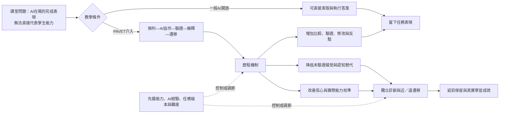

# （1）研究方法與實施步驟說明

## 研究題目

**生成式 AI 開放情境下，以 PAVET 真實學習證據鏈提升 Linux 容器化服務部署、監控與災難復原能力之研究**

本研究以「Linux 系統實務」課程為場域，探討學生在可使用生成式 AI 的情況下，是否能由單純完成指令與部署任務，進一步形成可診斷、可驗證、可解釋、可保留及可遷移的專業能力。教學介入採 PAVET 真實學習證據鏈，即預判（Predict）、AI 協作（AI-assisted action）、驗證（Verify）、解釋（Explain）與遷移（Transfer）。

## A. 研究架構

### （一）研究取向與設計

本研究採用**以量化為主、質性為輔的嵌入式混合方法教學行動研究**。量化資料用以檢驗 PAVET 對學生獨立遷移、延宕保留、診斷與驗證能力的影響；質性與歷程資料則用以說明學生如何使用 AI、介入在哪些環節產生作用，以及不同先備程度學生為何呈現不同結果。

研究包含三個相互連結的層次：

1. **短期成效比較：**第3至4週採單班、分層隨機、延遲介入之準實驗設計。依第1週先備測驗結果分層，再於各層內隨機分派為「先行介入組」與「延遲介入組」。先行介入組使用 PAVET，延遲介入組維持一般 AI 開放方式；兩組接受相同授課內容、任務時間與評量規準。第5週先進行延宕測量，再讓延遲介入組接受 PAVET，使全班後續均獲得完整教學介入。
2. **全學期行動研究：**第5至16週全班使用 PAVET，教師依兩個「規劃—行動—觀察—反思」循環調整鷹架、故障難度與評量方式。第一循環聚焦 Linux 服務診斷與自動化，第二循環聚焦容器化部署、可觀測性及災難復原。
3. **長期能力檢核：**第17至18週以異地主機重建、未見故障、RPO／RTO 檢核及個人微口試，測量遠遷移、延宕保留與技術決策說明能力。

採延遲介入而非 AB／BA 交叉設計，主要原因是 PAVET 屬於可學得的思考與驗證策略；學生一旦接受介入，後續很難回到未介入狀態，交叉設計可能受到明顯的攜帶效果。延遲介入仍能保留短期比較，並確保所有學生最終都獲得介入。

### （二）研究概念架構

### （三）主要變項

| 類型 | 變項 | 操作方式 |
|---|---|---|
| 教學介入 | 一般 AI 開放、PAVET | 是否要求完成 P、A、V、E、T 五階段及相應證據 |
| 主要結果 | 獨立近遷移、延宕保留、遠遷移 | 在 AI 暫停、未見變式或時間延宕後完成診斷與實作的規準分數 |
| 次要結果 | 診斷、驗證、除錯、解釋、任務完成時間 | 實作規準、微口試、系統紀錄及驗收結果 |
| 歷程機制 | 比較、驗證、修改、反駁、未驗證接受、直接索取完整答案 | AI 決策摘要、終端歷程與 PAVET 紀錄的行為編碼 |
| 後設認知 | 信心—表現校準誤差 | 任務前成功信心估計與實際獨立得分之差距 |
| 控制或調節 | 先備能力、AI 經驗、任務版本、出席、介入完成度 | 前測、背景問卷、任務與實施紀錄 |
| 實施成效 | 可接受性、可行性、教師與學生負荷、介入忠實度 | 問卷、訪談、教師札記及忠實度檢核表 |

## B. 研究問題／意識

本研究的核心意識是：生成式 AI 使「任務完成」與「學生能力形成」可能脫鉤，因此不能只比較成品分數或學生滿意度，而應檢查學生在 AI 暫停、題目變式與時間延宕後，是否仍能獨立診斷、驗證、解釋與復原系統。

### （一）研究問題

1. **RQ1：**相較於一般 AI 開放方式，PAVET 是否能提升學生在 AI 暫停情境下的獨立診斷與近遷移表現？
2. **RQ2：**PAVET 是否能提升學生一至二週後的延宕保留，以及學期末容器化服務部署、監控與災難復原的遠遷移表現？
3. **RQ3：**PAVET 是否能增加學生的驗證、比較、修改、反駁與因果解釋行為，並降低直接索取完整答案及未驗證接受？
4. **RQ4：**哪些 AI 協作與系統操作行為能預測獨立遷移與延宕保留？學生的信心與實際能力之校準是否獲得改善？
5. **RQ5：**先備能力、AI 使用經驗、任務難度與介入完成度是否影響 PAVET 的作用？PAVET 在約四十人的技術實作課程中是否可行並可持續實施？

### （二）研究假設

| 假設 | 預期方向 | 主要檢驗資料 |
|---|---|---|
| H1 | 先行介入組在第4週 AI 暫停的未見變式任務中，表現優於延遲介入組 | 近遷移規準分數 |
| H2 | 先行介入組在第5週、正式補充介入之前的延宕測量中，表現優於延遲介入組 | 延宕保留規準分數 |
| H3 | PAVET 條件下，學生的驗證、比較、修改、反駁與解釋行為較多且品質較高，未驗證接受較少 | 歷程編碼、驗證表與微口試 |
| H4 | 控制先備能力後，驗證、比較、修改及反駁行為正向預測獨立遷移；直接索取完整答案及未驗證接受負向預測獨立遷移 | 歷程行為比例與遷移分數 |
| H5 | PAVET 條件下，學生的信心與實際獨立表現之校準誤差較小 | 信心評分與獨立表現 |

「PAVET 透過驗證與解釋行為影響遷移」暫列為探索性機制分析。約四十人的單班樣本不宜將複雜中介或多重調節模型列為主要假設，以免超出資料所能支持的推論。

## C. 研究範圍

### （一）課程與內容範圍

研究範圍為一學期三學分、十八週的「Linux 系統實務」或後續確認之正式課名。教學內容包含 Linux 權限、網路、systemd、日誌、Shell／Python 自動化，以及後半學期的容器化服務部署、監控告警、備份與災難復原。期末整合任務以教師提供的統一輕量應用為工作負載，學生負責映像製作、多容器部署、TLS、機密管理、健康檢查、監控告警、備份還原與異地主機重建。

本研究聚焦的不是網站或應用程式開發能力，而是學生能否：

1. 依系統狀態提出故障假設及檢查順序。
2. 對 AI 建議進行採用、修改或拒絕的技術判斷。
3. 以日誌、指標、命令輸出及正負向測試驗證結論。
4. 在未見變式、AI 暫停及時間延宕後保留與遷移能力。
5. 完成容器化服務的監控、備份、復原及 RPO／RTO 檢核。

### （二）教材、資源與協作範圍

- 教材包含微講授、已解工作範例、PAVET 紀錄表、動態參數任務、故障注入腳本、驗證清單、微口試題組及復原操作手冊模板。
- 技術環境包含 Linux Server 虛擬機或雲端主機、Docker、Compose 或同等工具、版本庫、映像倉庫，以及監控與告警工具。
- 全班約四十人，平時可分為十組，每組四人，輪替擔任診斷者、操作者、驗證者及紀錄說明者；主要研究結果仍以個人證據為單位。
- 教師負責教學介入與課程調整；如有助教，助教依共同規準協助環境重置、現場觀察與評分，但不得自行改變評分判準。

### （三）研究界線

本研究不以辨識作業是否由 AI 撰寫為目的、不使用 AI 偵測器判定學生能力或違規、不比較特定 AI 品牌優劣，也不把提示詞數量或對話長度直接視為學習成效。研究結論主要適用於單一校系的 Linux 技術實作課程，不直接推論至所有學科或所有年級。

### （四）技術實作專案之場域與模式

若本案以「技術實作專案計畫」提出，實作場域為校內電腦教室、學生個人電腦與經核准之雲端或虛擬化 Linux 環境。實作教學採「短講示範—引導實作—故障注入—PAVET 證據鏈—個人變式—異地主機重建」模式。學生須在受控環境完成真實部署、監控、事件診斷與災難復原，不得掃描或操作未授權之校內外主機。

本草案未納入校外社會實踐場域，因此目前不屬 USR 研究設計；若實際申請類別為 USR，須另補充合作場域、社會議題、利害關係人需求及課程—場域協作機制。

## D. 研究對象與場域

### （一）研究對象

研究對象預計為資訊管理相關科系大學部三年級「Linux 系統實務」選修課程學生，預估約四十人。實際人數、性別、先修課程、Linux 經驗、程式能力與生成式 AI 使用經驗，於開學後依實際修課資料及基線問卷取得，不預先虛構。

所有修課學生均接受正常教學；只有完成知情同意者的資料納入研究。不同意或中途撤回者仍可參與所有課程活動與評量，其成績與學習權益不受影響，研究資料庫則排除其個人資料。

### （二）研究場域

研究場域包含：

1. 實體電腦教室及課堂中的個人、分組實作活動。
2. 每位學生或每組配置的 Linux 虛擬機、雲端主機或隔離容器環境。
3. 課程學習平台、版本庫及研究用資料收集表單。
4. 經課程規範允許的生成式 AI 工具與官方技術文件。

### （三）分組與訪談取樣

第1週前測後，以先備能力分層，再於各層內隨機分派至先行介入組與延遲介入組，降低兩組起始能力差異。此分派只用於第3至5週研究條件，不影響原有課程分組與成績。質性訪談預計依「高、中、低先備能力」及「高、低遷移表現」進行最大差異取樣，約邀請9至12名自願者；實際人數以資料飽和度、研究同意及可行性為準。

本研究以實際修課班級為完整取樣範圍，樣本數受選課人數與研究同意人數限制，不為追求統計顯著而任意擴充或排除個案。正式分析前將依有效樣本進行敏感度或可偵測效果評估，並以效果量、信賴區間及多來源證據界定結論強度。

### （四）倫理與角色權力處理

- 研究開始前依學校規定辦理研究倫理審查或確認適用程序。
- 知情同意盡量由非授課教師或不參與成績評定者說明與收取；若無此人力，須以書面清楚說明自願性與退出權利。
- 研究資料以代碼取代姓名、學號與帳號；評分用資料與研究分析資料分開保存。
- 教師在學期成績送出前只接觸教學所需資料，不查看研究同意名單或可識別的訪談分析結果。
- AI 對話、終端紀錄及設定檔在上傳前移除 IP、帳號、金鑰、Token、憑證及其他敏感資訊。
- 資料保存年限、加密位置、存取人員與銷毀方式依校級規範填寫。[NEEDS PROFESSOR INPUT: 學校研究倫理規範、保存年限及負責單位]

## E. 研究方法與工具

### （一）資料蒐集工具及選擇理由

| 工具 | 蒐集內容 | 選擇理由 | 對應問題 |
|---|---|---|---|
| 先備能力測驗 | Linux 基礎、權限、網路、服務與日誌判讀 | 控制起始差異並進行分層分派 | RQ1、RQ4、RQ5 |
| AI 使用背景問卷 | 使用頻率、常見用途、信任、查證習慣與自我效能 | 說明學生原有 AI 使用型態，不以自陳直接取代能力測量 | RQ4、RQ5 |
| 等值故障任務 | 權限、服務、網路、TLS、容器、儲存或告警故障 | 動態系統狀態較能測量診斷與修正，而非重播固定答案 | RQ1、RQ2 |
| AI 暫停近遷移與延宕任務 | 前10至15分鐘獨立診斷，之後可開放 AI 比較 | 分開測量學生能力與人機聯合表現 | RQ1、RQ2、RQ4 |
| PAVET 紀錄表 | 預判、AI 建議、採用／修改／拒絕、驗證、解釋與遷移 | 將原本不可見的認知責任與決策過程轉成可分析證據 | RQ3、RQ4 |
| 終端與版本歷程 | 重要命令、錯誤訊息、設定差異、提交與回復 | 交叉檢查學生自述，還原實際診斷與修正順序 | RQ3、RQ4 |
| 實作評分規準 | 功能、診斷、驗證、除錯決策、解釋及遷移 | 避免只以最終服務是否啟動作為成效 | RQ1至RQ4 |
| 信心評分 | 每次獨立任務前估計成功機率或理解程度 | 計算學生自評與實際表現的校準誤差 | RQ4 |
| 結構化微口試 | 故障原因、證據、替代方案與下一步 | 檢查學生能否重建因果與處理追問 | RQ2、RQ3 |
| 半結構訪談 | AI 是工具、導師或拐杖的關鍵時刻，以及介入負荷 | 解釋量化差異與學生採用或抵抗 PAVET 的原因 | RQ3至RQ5 |
| 忠實度表與教師札記 | 各階段是否實施、所需時間、技術問題與臨場調整 | 判斷無效果究竟是理論失效或實施不足 | RQ5 |

### （二）研究問題、證據與分析對照

| 研究問題 | 核心證據 | 主要比較或分析 |
|---|---|---|
| RQ1：獨立診斷與近遷移 | 前測、第4週 AI 暫停變式、實作規準 | 先行／延遲介入組比較，控制前測與任務版本 |
| RQ2：延宕保留與遠遷移 | 第5週延宕任務、第17週重建演練、第18週故障與口試 | 第5週組間比較；學期末全班重複測量與個案證據 |
| RQ3：驗證與解釋行為 | PAVET 表單、AI 決策、終端紀錄、微口試 | 行為頻率與品質比較、歷程編碼及主題分析 |
| RQ4：歷程—結果與校準 | AI 行為、信心、近遷移與延宕成績 | 少數理論指定變項的相關或迴歸、絕對校準誤差 |
| RQ5：差異與可行性 | 先備能力、AI 經驗、忠實度、負荷、訪談與教師札記 | 分層描述、探索性交互作用、可行性指標與主題分析 |

### （三）評量規準與主要結果

實作任務使用共同分析規準：系統功能25%、問題診斷與命令理由20%、驗證設計與證據品質20%、除錯修正與決策品質15%、口頭解釋10%、變式遷移10%。研究的**主要結果**為 AI 暫停時的近遷移分數及第5週延宕保留分數；學期末遠遷移、RPO／RTO 達成、歷程行為、微口試與校準誤差為次要或解釋性結果。如此可避免只因 PAVET 增加書寫紀錄，就誤判介入有效。

### （四）工具品質控制

1. 邀請 Linux／雲端技術教師及教學評量專長者檢核任務內容、難度、規準與研究問題對應性。[NEEDS PROFESSOR INPUT: 可協助檢核的2至3名專家]
2. A、B 任務版本保持相同概念、步驟數、故障層次與時間限制，只改變參數及表面情境；在正式研究前由非研究班學生、助教或歷屆學生進行小規模試作。[NEEDS PROFESSOR INPUT: 是否有可進行前導試作的人員與時間]
3. 微口試使用共同題幹與等值追問，評分聚焦技術因果、證據及修正，不把口語流利度當作專業能力。
4. 抽取至少20%的作品及歷程資料由第二評分者獨立評分；類別編碼檢查 Cohen's kappa，連續規準分數檢查組內相關係數或其他適當一致性指標。
5. 每次課堂記錄介入完成度、教師提示程度、AI 是否開放、故障版本及環境異常，以確認實施忠實度。

## F. 資料處理與分析

### （一）資料整理

1. 建立匿名研究代碼，另以加密對照表管理身分；分析檔不含姓名、學號、帳號與主機識別資訊。
2. 建立資料字典，統一變項名稱、分數範圍、時間點、任務版本、缺失值原因與排除規則。
3. 將評量分數、信心值、完成時間、AI 行為編碼、終端事件、問卷及訪談資料以研究代碼與時間點連結。
4. 先檢查遺漏、極端值、未完成任務、技術故障及介入忠實度；區分學生缺席、系統問題與真實未完成，不任意把缺失值當零分。
5. 保留原始資料、清理後資料與分析程式版本，建立可追蹤的處理紀錄。

### （二）量化分析

1. **描述統計：**呈現各時間點的平均數、中位數、標準差、四分位距、完成率與信賴區間，並檢視兩組的基線可比性。
2. **H1與H2主要分析：**以第4週近遷移及第5週延宕保留分數為依變項，介入組別為主要自變項，控制前測、任務版本及必要的背景變項。若分數分配及樣本條件適合，使用共變數分析或線性模型；若假設不符，採穩健估計、無母數比較或 bootstrap 信賴區間。
3. **效果量：**除 p 值外，同時報告調整後平均差、標準化效果量及95%信賴區間。單班小樣本以效果方向、幅度與不確定性為主要解讀，不把「未達顯著」直接解釋為沒有效果。
4. **H3歷程差異：**比較兩組在驗證、比較、修改、反駁、直接索取答案及未驗證接受等行為的次數、比例與品質分數；分析時考量任務總操作量或對話長度。
5. **H4預測分析：**以獨立遷移或延宕保留為結果，檢驗先備能力、驗證行為、未驗證接受與直接索取答案的關聯。因樣本數有限，模型僅保留少數理論指定變項，避免資料驅動的多重檢定。
6. **H5校準分析：**將0至100的信心估計與標準化實際得分相比，計算絕對校準誤差；另檢查過度自信與低估能力的方向性誤差。
7. **全學期變化：**以第1、4、5、9、17或18週的重複測量呈現成長軌跡。因第5週後全班均接受 PAVET，後期結果用於觀察維持、遷移與實施效果，不再宣稱為兩組長期因果差異。

### （三）質性與歷程分析

1. 先依研究問題建立初始編碼架構，包括直接索取完整答案、概念提問、故障診斷、比較、驗證、修改、反駁、未驗證接受及反思校準，再保留資料驅動的新類別。
2. 以 AI 決策摘要、PAVET 表單、終端歷程、微口試與訪談進行主題分析，重建學生由「AI代做」轉向「AI協作」，或由「AI鷹架」轉為「依賴」的關鍵歷程。
3. 第二編碼者先以共同樣本校準，達成規則共識後再獨立編碼抽樣資料；不一致處保留討論紀錄並修訂編碼手冊。
4. 主動尋找反例，例如大量使用 AI 但遷移良好，或完整填寫 PAVET 卻無法獨立操作的學生，以避免只挑選支持假設的案例。

### （四）混合資料整合

量化與質性結果以聯合展示表整合。例如，將近遷移進步幅度、校準誤差、AI 行為分布、終端診斷路徑及訪談主題並列，檢查「同樣完成任務但能力形成不同」的個案。若量化與質性結果不一致，將其視為需解釋的結果，而非只採用支持預期的一方。

### （五）效度威脅與處理

| 潛在威脅 | 可能影響 | 處理方式 |
|---|---|---|
| 單班、小樣本 | 統計力與外推有限 | 報告效果量、信賴區間與個案證據，不過度宣稱普遍因果 |
| 同班組間污染 | 延遲組可能學到 PAVET 做法 | 測量時使用個別表單與不同參數；記錄跨組交流；第4至5週盡快完成主要測量 |
| 任務不等值 | 成績差異可能來自題目難度 | 專家檢核、前導試作、版本平衡及模型控制任務版本 |
| 教師兼研究者 | 提示、評分與訪談可能受期待影響 | 固定提示規則、盲化第二評分、保留評分紀錄，訪談盡量由非授課者進行 |
| AI 模型與平台變動 | 不同工具能力造成額外差異 | 指定共同可用平台或完整記錄工具、版本與日期；主要結論聚焦行為與證據鏈 |
| 技術環境故障 | 可能被誤判為學生能力不足 | 建立環境檢核表、快照與故障事件紀錄，區分課程故障與研究任務故障 |

## G. 實施程序

| 階段 | 時間 | 主要工作 | 蒐集資料與品質檢核 |
|---|---|---|---|
| 研究準備 | 開課前8至4週 | 確認研究倫理程序；完成任務藍圖、PAVET 表單、規準、訪談大綱及資料管理計畫 | 專家內容檢核、研究問題—工具對照 |
| 環境與前導 | 開課前4至1週 | 建置 Linux、容器、版本庫與日誌環境；試作 A／B 等值任務、故障注入及復原流程 | 難度、時間、故障可重現性與敏感資訊檢查 |
| 基線 | 第1週 | 說明研究與取得同意；進行先備能力、AI 經驗、自我效能與基礎信心測量 | 前測、背景問卷、研究代碼 |
| 共同準備 | 第2週 | 教授共同的 AI 資料安全、任務規準及基本驗證觀念；完成組別分層分派 | 基線平衡、工具與環境可用性 |
| 延遲介入比較 | 第3至4週 | 先行介入組依數位材料接受 PAVET 指引；延遲介入組依等時長的一般任務說明完成等值 Linux 故障任務；教師只提供兩組共通的技術支援 | 當下表現、AI 決策與終端歷程、信心、近遷移；介入忠實度 |
| 延宕測量與全面介入 | 第5週 | 課程開始時先進行 AI 暫停延宕測量；完成後對延遲組補充 PAVET，轉為全班介入 | H2主要結果；確認全班理解 PAVET |
| 行動研究循環一 | 第5至9週 | 在 DNS／檔案服務、自動化、Python、監控及期中故障診斷中使用完整鷹架，再依證據調整 | PAVET作品1至2、自動化任務、期中個人診斷、教師札記 |
| 中期反思 | 第9週後 | 檢查學生卡關、介入負荷、規準使用與提示程度，修訂後半學期鷹架 | 中期成效摘要、規準校準與修訂紀錄 |
| 行動研究循環二 | 第10至16週 | 在映像、網路、儲存、Compose、TLS、監控告警與備份還原中漸退鷹架 | PAVET作品3至6、專案檢核、微口試、歷程資料 |
| 遠遷移與災難演練 | 第17週 | 從空白或替代主機重建服務，處理未見故障並實測 RPO／RTO | 遠遷移、延宕保留、復原證據與訪談取樣依據 |
| 期末整合 | 第18週 | 容器化服務現場驗收、隨機故障注入、個人微口試、後測與課程經驗調查 | 期末規準、校準誤差、接受度與可行性資料 |
| 訪談與分析 | 成績送出後 | 進行自願訪談；完成第二評分、資料清理、量化與質性分析及聯合展示 | 評分一致性、編碼紀錄、反例與稽核軌跡 |
| 回饋與改進 | 分析完成後 | 將整體研究結果回饋課程設計，修訂任務、鷹架、評量規準與下一輪實施方式 | 不揭露個人身分的整體結果與課程修正紀錄 |

## 尚待確認事項

1. [NEEDS PROFESSOR INPUT: 正式課名、課號、開課學期及預估／實際修課人數]
2. [NEEDS PROFESSOR INPUT: 計畫申請類別是否為技術實作專案；若為一般計畫可刪除專案類別說明，若為 USR 則須重建場域合作段落]
3. [NEEDS PROFESSOR INPUT: 全班是否能使用相同生成式 AI 平台或帳號；若不能，將如何記錄工具與版本差異]
4. [NEEDS PROFESSOR INPUT: 監控工具採 Prometheus／Grafana、Netdata、Uptime Kuma 或其他組合]
5. [NEEDS PROFESSOR INPUT: 是否有助教、第二評分者、外部訪談者及2至3名專家可協助]
6. [NEEDS PROFESSOR INPUT: 校級研究倫理審查、知情同意、資料保存年限與資料儲存規範]
7. [NEEDS PROFESSOR INPUT: 是否有歷屆學生、非研究班級或助教可進行等值任務前導試作]

本文件為研究方法草案。延遲介入組別、主要結果、資料蒐集強度與統計模型，須在修課人數、倫理程序及可用人力確認後定稿；未確認前不將研究設計標示為最終版本。
